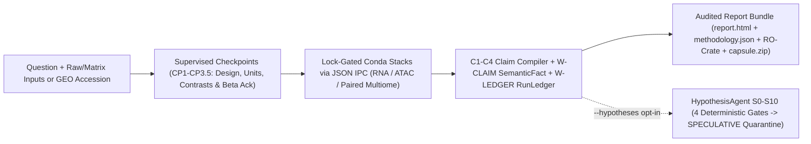

# ARIA — Agentic Research Intelligence for Supervised Omics Analysis

> **Ask the biological question. Confirm the experimental design. Execute in hermetic scientific stacks. Publish only what structured evidence supports.**


**ARIA (`aria-omics`)** is an open-source, evidence-governed control plane for bulk, single-cell, chromatin, and paired multi-omic biology. Instead of letting a language model improvise statistical scripts or fill analytical gaps with plausible prose, ARIA separates **human-confirmed experimental design**, **lock-pinned deterministic bioinformatics execution**, **compiler-enforced public claim verification (`C1–C4`)**, and **mechanically quarantined hypothesis generation (`S0–S10`)**.

Every report bundle stamps the package version (**`4.8.0`**), exact Git commit, dirty state, workflow hash, input SHA-256 digests, Conda/PyPI lockfile hashes, and LLM determinism provenance — so package version alone is never treated as a complete reproducibility pin.

---

## System Architecture at a Glance



---

## Six Mechanical Guarantees

1. **Design before compute (`B1` / `B2` / `P0-5`).** Groups, biological units vs technical replicates (`_repN`), covariates, batch confounding vetoes, reference levels, and contrasts are confirmed at explicit checkpoints before statistical dispatch. Silent filename/column-name design guessing is disabled in production.
2. **Zero silent fabrication (`ADR-002` / `P-FAKE-GUARD`).** Unmeasured metrics remain `None` (`not measured`), underpowered or missing-resource stages return structured skips, and AST guards forbid mock fallbacks or hash-derived numbers on production paths.
3. **Compiler-enforced public claims (`C1–C4` / `W-CLAIM` / `W-LEDGER`).** Untrusted inputs are isolated inside `<untrusted_data>` JSON envelopes (`C1`). Public claims must match structured `EvidenceCard` numbers, entities, and directional/null polarity (`C2`), link to executed `RunLedger` nodes (`C3`), and cap observational omics at the `associative` tier unless an exact interventional estimand is licensed (`C4`).
4. **Fail-closed monotone provider invariance (`Claim 6`).** LLM calls run at `temperature=0`; a fixed seed is sent only to backends that accept one, and reports disclose whether the answering backend is seed-deterministic. Because structured findings are rendered deterministically from `EvidenceCard`s and dual-verified, LLM variation may cause an overreaching claim to be withheld, never added or elevated.
5. **Non-circular multiome triangulation & `SPECULATIVE` quarantine (`ADR-057` / `ADR-070` / `ADR-072`).** Shared upstream cis lineage (`peak2gene` $\rightarrow$ `eRegulons`) is tracked in code so correlated representations never self-inflate into independent contrast replication, and the opt-in `HypothesisAgent` (`S0–S10`) is mechanically walled (`promotable: false`, `assert_no_speculative_promotion`) from public claims.
6. **Hermetic scientific stacks (`A5`).** Heavy bioinformatics runs in dedicated Conda environments verified against committed `@EXPLICIT` Conda and PyPI lockfiles. The orchestrator never substitutes `aria-env` for a missing scientific stack.

---

## Capability & Readiness Matrix (`v4.8.0`)

`aria/agents/orchestrator_agent.py` (`MODALITY_VALIDATION` and `INTEGRATION_VALIDATION`) is the single runtime source of truth, guarded against documentation drift in CI ([Validation Status](docs/validation_status.md)):

| Workflow / Layer | Readiness Tier | Dispatch Policy | Key Analytical Scope |
| :--- | :--- | :--- | :--- |
| **scRNA-seq** (`.h5ad`, 10x `.h5`/MEX, `kb-python` 3'/5'/plate FASTQ) | **Production** | Enabled | 3'/5'/plate `kb count` (`10x`, `Smart-seq3`, `BD Rhapsody`, `CEL-Seq2`, `SPLiT-seq`), QC, Harmony, clustering, CellTypist/markers, donor-aware `pyDESeq2` pseudobulk DE, ORA, beta PAGA/DPT & LIANA |
| **Bulk RNA-seq count matrices** | **Production** | Enabled | Metadata correspondence gate, technical-replicate summation, `pyDESeq2` (`lfcThreshold` Wald + apeGLM), outlier sensitivity, local GMT ORA & GSEA |
| **Bulk RNA-seq raw FASTQ** (`full_length`, 3'/5' tag, UMI & plate) | **Production** | Enabled | Universal preprocessing across standard SE/PE/multi-lane (`STAR` 2-pass), 3'/5' tags (`QuantSeq`, `SMART-3Seq`, `CAGE`), inline-UMI (`pysam` directional 1-MM dedup), and multiplexed plates (`BRB-seq`/`DRUG-seq`/`Prime-seq` via `STARsolo`) with `CPM` export and length-bias `TPM` suppression |
| **scATAC-seq** (`.h5mu`, fragments, `chromap` FASTQ) | **Beta** | Explicit `CP3.5` ack | Measured QC, TF-IDF/LSI, donor-aware pseudobulk DA, `JASPAR2024` motifs, cis `peak2gene`, descriptive/replicate `TOBIAS` footprinting |
| **Bulk ATAC-seq** (FASTQ / BAM / CRAM) | **Beta** | Explicit `CP3.5` ack | `bwa-mem2` alignment, QC, `MACS3` consensus peaks, `bedtools` counts, replicate-gated `pyDESeq2` DA, annotation, ORA, motifs & `TOBIAS` |
| **Paired 10x Multiome** (same-cell `.h5mu` RNA + ATAC) | **Beta** | Explicit `CP3.5` ack | Joint QC, Seurat-concordant `WNN` + 5-axis guardrail, `MOFA+`, Signac-faithful `peak2gene`, candidate `eRegulons` & Cross-Modal Evidence Graph |
| **Cross-Modal `HypothesisAgent` (`S0–S10`)** | **Quarantined Opt-In** | `--hypotheses` (`OFF` default) | 5 zero-LLM evidence adapters + 4 deterministic gates $\rightarrow$ `speculative_hypotheses.json` (`promotable: false`) |
| **ChIP-seq, CUT&RUN, CUT&TAG, Hi-C** | **Scaffold** | Disabled | Explicit scaffolds (`Hi-C` experimental opt-in only via `ARIA_ALLOW_EXPERIMENTAL_HIC=1`) |
| **Unpaired / diagonal multimodal integration** | **Blocked** | Fail-closed | Rejected at `enforce_same_cell_integration_gate` while preserving single-assay lanes |

> **Scope note:** “Production” and “Beta” describe ARIA's software validation boundary, not whether a specific biological dataset is ready for publication. Domain-expert review of experimental design, model specification, power, QC, and biological interpretation remains mandatory.

---

## Verified External Concordance & Governance Benchmarks

All 18 executable machine lanes in [`docs/benchmark_results/preprint_v1/`](docs/benchmark_results/README.md) and the V48 multiome concordance suite ([`docs/benchmark_results/multiome_concordance/`](docs/benchmark_results/README.md)) are reproducibly verified from a clean checkout:

| Track / Modality | External Reference / Ground Truth | Measured ARIA Concordance / Governance Metric |
| :--- | :--- | :--- |
| **A1 Bulk RNA-seq DE** | SEQC/MAQC TaqMan qPCR (`BGI`) & 5 Illumina sites | TaqMan LFC **Pearson $r = 0.944$** (`AUC = 0.893`, `97.5%` titration monotonicity); 5-site cross-lab **mean $r = 0.980$** |
| **A1 ERCC Spike-Ins** | Thermo ERCC Mix1/Mix2 (`92` controls) | Fold-change **Pearson $r = 0.902$**; dynamic-range linearity **$r = 0.976$** across $6.3$ $\log_{10}$ orders |
| **A2 scRNA Pseudobulk DE** | Kang et al. 2018 (`8v8` lupus IFN-$\beta$) vs `muscat` (`edgeR-QLF`) | Mean per-cell-type LFC **Pearson $r = 0.976$**, signal **Spearman $\rho = 0.985$**, **`100%` sign agreement** (`4,921` shared DEGs) |
| **scATAC Donor-Aware DA** | `GSE278576` (`5` young vs `5` old human hippocampus donors) | `100%` subset precision vs R `DESeq2` (`2,052` consensus DA peaks; `edgeR`/`limma` concordant) |
| **V48 Multiome Tier 1 (`WNN`)** | R `Seurat 5.3.0` (`FindMultiModalNeighbors`, `GSE278576` `hc11`) | Cluster **`ARI = 0.9582`** (`NMI = 0.9660`), modality weight **Spearman $\rho = 0.9277$** (`MAE = 0.0275`), `6/6` rare subclasses retained |
| **V48 Multiome Tier 2a (`MOFA+`)** | `muon.tl.mofa` (`hc11`, `2,517` paired cells) | Hungarian $R^2$-weighted factor **`|r| = 0.9730`**, subspace correlation **`0.9895`**, automatic technical depth factor exclusion |
| **V48 Multiome Tier 2b (`peak2gene` & `eRegulons`)** | R `Signac::LinkPeaks` & Python `SCENIC+ 1.0.0` (`hc11`) | `LinkPeaks` **`Jaccard = 0.8670`** (`score_pearson = 1.0000`); **`17.99x` edge fold-enrichment** ($p = 2.93 \times 10^{-15}$) vs `SCENIC+` (`5.4x` faster) |
| **B1 / B2 / B4 Governance** | Adversarial design, 4-arm claim ablation & RNA+ATAC null permutations | **`0.0` unsafe execution rate** (`23/23` B1); **`1.0 -> 0.0` causal-overreach reduction** (B2); **`0.0` fabricated narrative rate** on null controls (B4/C5) |

---

## Quick Start

ARIA targets **Ubuntu 22.04+ / WSL2** with **Python 3.11** and committed Linux `linux-64` scientific locks.

### 1. Guided workstation setup
```bash
git clone https://github.com/Olascoaga/aria-omics.git
cd aria-omics
bash install.sh
conda activate aria-env
aria doctor --smoke
aria
```

### 2. Lightweight source install (when Conda is already present)
```bash
conda create -n aria-env python=3.11 -y
conda activate aria-env
python -m pip install -e '.[tui]'
aria doctor --smoke
```

Install modality-specific scientific stacks from the committed lockfiles as needed (see the [Installation Guide](docs/INSTALLATION.md)):

```bash
conda create --name aria-rna-env --file envs/aria-rna-env.linux-64.lock
conda run --name aria-rna-env python -m pip install --no-deps --requirement envs/aria-rna-env.pip.lock
python -m aria.utils.environment_audit --env aria-rna-env
```

---

## Launch Modes & Reproducibility Utilities

```bash
aria                        # Interactive Textual Control Center (intake, checkpoints, RunLedger, artifacts)
aria --classic-tui          # Classic Rich terminal prompt flow
aria --reproducible         # Reproducible run (exports single-experiment SQLite + RO-Crate + capsule)
aria --hypotheses           # Opt in to the quarantined HypothesisAgent (SPECULATIVE appendix)

aria diff REPORT_A REPORT_B # Structured claim, tier, and RunLedger diff across two report bundles
aria export REPORT_DIR      # Emit ro-crate-metadata.json and atomic SHA-256 capsule.zip
aria reproduce CAPSULE.zip  # Verify capsule hashes, SQLite scope, lock digests, and public claim set
```

For batch automation and test harnesses, use `aria.headless.run_headless` with an explicit checkpoint policy ([CLI & Headless Guide](docs/CLI_AND_HEADLESS.md), [Control Center Guide](docs/CONTROL_CENTER.md)).

---

## Hermetic Scientific Stacks

`aria.utils.environment_specs.ENVIRONMENT_SPECS` owns all subprocess routing and lock verification:

| Environment | Lock Status | Analytical Role |
| :--- | :--- | :--- |
| `aria-rna-env` | **Locked** | scRNA, bulk RNA DE, donor-aware pseudobulk DE, and shared `pyDESeq2` chromatin DA |
| `aria-ingestion-env` | **Locked** | Raw scRNA FASTQ quantification (`kb-python` / `kallisto` / `bustools`) |
| `aria-rnaseq-env` | **Locked** | Universal raw bulk RNA FASTQ QC, alignment, UMI collapse, `STARsolo` plate demux, and counting (`fastp`, `STAR`, `pysam`, `featureCounts`) |
| `aria-atacseq-env` | **Locked** | Bulk ATAC (`bwa-mem2`) and scATAC (`chromap`) raw-read alignment |
| `aria-chromatin-env` | **Locked** | Chromatin QC, `MACS3` peaks, `SnapATAC2` matrices/LSI, motifs, and `WNN` joint topology |
| `aria-tobias-env` | **Locked** | `TOBIAS` Tn5-bias-corrected transcription factor footprinting |
| `aria-integration-env` | **Locked** | Paired 10x Multiome `MOFA+` (`mofapy2`), `muon`/`mudata`, `peak2gene`, and candidate `eRegulons` |
| `aria-bench-env` | **Locked** | External R/Bioconductor benchmark comparators (`DESeq2`, `edgeR`, `limma-voom`) |
| `aria-hic-env` | Scaffold | Dispatch-disabled Hi-C / Micro-C scaffold (`lock_required=False`) |

---

## Provider Routing & Air-Gapped Privacy

ARIA supports **Anthropic**, **OpenAI**, **Google Gemini**, and local **Ollama-compatible** OpenAI/loopback endpoints (`~/.aria/config.yaml`). Raw omics matrices remain local, while configured cloud models receive the biological question and structured summaries inside `<untrusted_data>` envelopes.

To enforce zero network egress from process start (blocking cloud LLMs, Enrichr, GEO/SRA, and child-process egress), configure a local model and export `ARIA_AIR_GAPPED=1` **before** launching ARIA:

```bash
export ARIA_AIR_GAPPED=1
aria doctor --llm
aria doctor --secrets
aria
```

---

## Audit-Ready Report Bundles

Every completed run writes a self-contained, non-overwritable bundle:

```text
aria_<timestamp>_<slug>_<id>/
├── report.html                  # Evidence-linked HTML report + copy-pasteable Methods
├── methodology.json             # Compiled claims, EvidenceCards, RunLedger, caveats & full provenance
├── figures/                     # Publication figures (300-DPI PNG + editable vector SVG)
├── tables/                      # Supplementary CSV/TSV outputs (DE, DA, ORA/GSEA, MOFA+, peak2gene, eRegulons)
├── memory_snapshot.sqlite       # Single-experiment ARIAMemory decision & tunnel snapshot
├── ro-crate-metadata.json       # W3C RO-Crate 1.1 provenance graph
├── capsule.zip                  # Portable SHA-256 verification capsule
└── speculative_hypotheses.json  # Emitted ONLY when `--hypotheses` is opted in (promotable: false)
```

---

## Documentation Map

- **[Documentation Hub](docs/README.md)** — complete index of user, workflow, and governance guides
- **[Installation Guide](docs/INSTALLATION.md)** — Ubuntu/WSL2 setup, exact lock reconstruction, and LLM config
- **[CLI & Headless Guide](docs/CLI_AND_HEADLESS.md)** — CLI flags, `aria doctor`, capsules, and `run_headless`
- **[Control Center Guide](docs/CONTROL_CENTER.md)** — interactive Textual cockpit views and shortcuts
- **[Validation Status](docs/validation_status.md)** — test-guarded per-modality and paired-multiome readiness matrix
- **[Architecture Overview](docs/architecture/overview.md)** & **[Code Dependency Graph](docs/architecture/code_graph.md)**
- **[Reporting & Claim Governance](docs/architecture/reporting_and_outputs.md)** & **[Biological Synthesis](docs/architecture/biological_synthesis.md)**
- **[HypothesisAgent & `SPECULATIVE` Quarantine](docs/architecture/hypothesis_agent.md)**
- **[Preprint-v1 Evidence Freeze](docs/architecture/preprint_freeze_v1.md)** & **[Benchmark Artifacts](docs/benchmark_results/README.md)**
- **[Workflow Guides](docs/workflows/)** — [Bulk RNA](docs/workflows/bulk_rna.md) · [scRNA](docs/workflows/scrna.md) · [Pseudobulk](docs/workflows/pseudobulk_scrna.md) · [Chromatin](docs/workflows/chromatin_roadmap.md) · [Paired Multiome](docs/workflows/integration_roadmap.md)
- **[Changelog](CHANGELOG.md)** & **[v4.8.0 Release Notes](docs/release_notes_v4.8.0.md)**

---

## Development & Verification

```bash
python -m pip install -e '.[dev,tui]'
python -m pytest -q \
  tests/test_packaging.py \
  tests/test_docs_drift_guard.py \
  tests/test_preprint_audit_q1_doc_claims.py \
  tests/test_public_artifacts_no_absolute_paths.py \
  tests/test_registry_integrity.py
```

Consult [`docs/architecture/code_graph.md`](docs/architecture/code_graph.md) before modifying shared paths. Note that [`docs/benchmark_results/preprint_v1/`](docs/benchmark_results/preprint_v1/inventory.json) binds receipts to the clean indexed Git tree (`v4.8.0` is the current release tag), so any tracked code or documentation edit requires refreshing machine freeze receipts before cutting a frozen preprint snapshot.

---

## License

MIT License — free for academic and commercial use.
