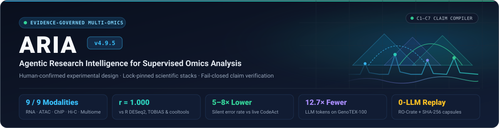
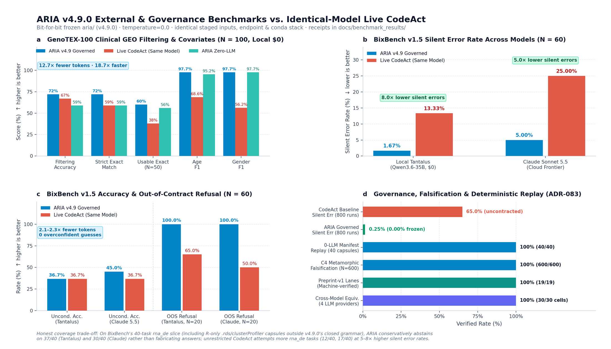
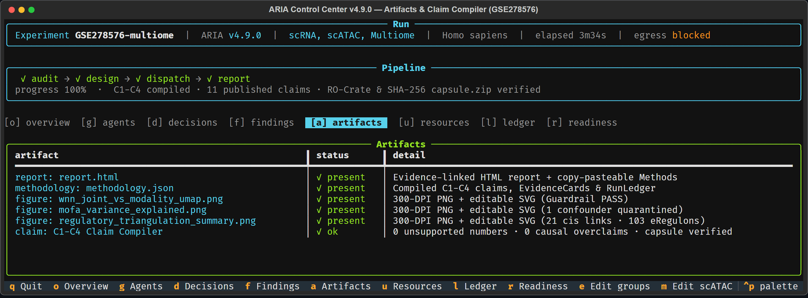
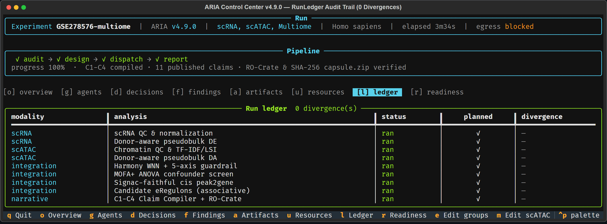
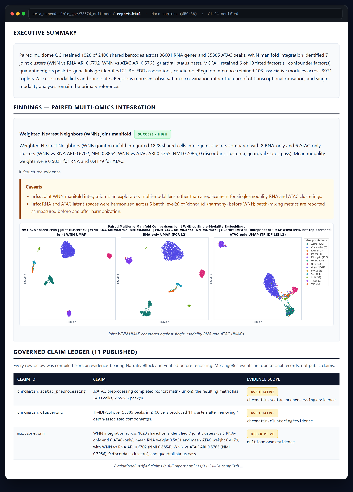
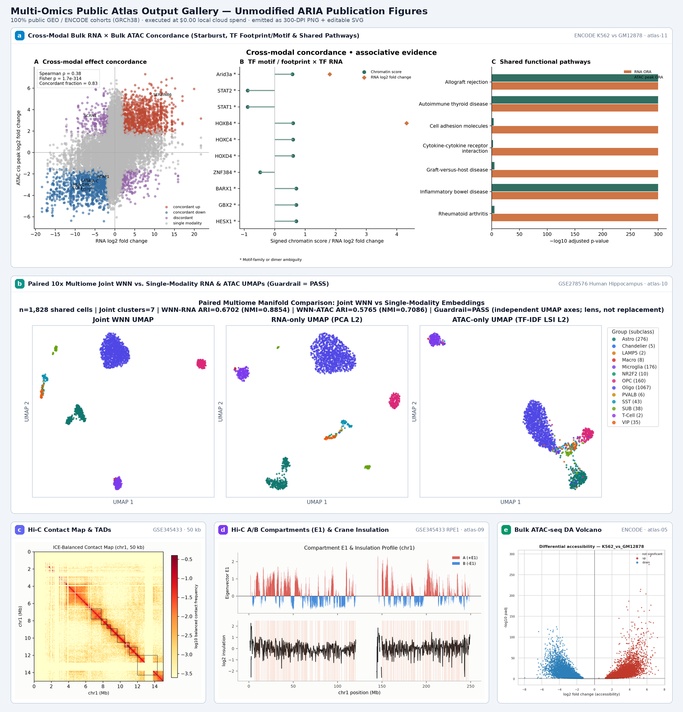
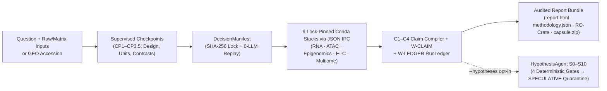

<p align="center">
  
</p>

<div align="center">


[](https://github.com/Olascoaga/aria-omics/actions/workflows/ci.yml)


</div>

<p align="center">
  <strong>Ask the biological question. Confirm the experimental design. Execute in hermetic scientific stacks. Publish only what structured evidence supports.</strong>
</p>

<p align="center">
  <a href="#external-benchmarks-vs-live-codeact-v490">Benchmarks</a> &nbsp;&middot;&nbsp;
  <a href="#interactive-control-center--audited-reports">Control Center &amp; Reports</a> &nbsp;&middot;&nbsp;
  <a href="#multi-omics-output-gallery">Multi-Omics Gallery</a> &nbsp;&middot;&nbsp;
  <a href="#system-architecture">Architecture</a> &nbsp;&middot;&nbsp;
  <a href="#capability--readiness-matrix-v495">Modalities</a> &nbsp;&middot;&nbsp;
  <a href="#quick-start">Quick Start</a> &nbsp;&middot;&nbsp;
  <a href="#documentation-map">Docs</a>
</p>

---

## Why ARIA?

**ARIA (`aria-omics`)** is an open-source, **evidence-governed multi-omics control plane** spanning bulk RNA-seq, scRNA-seq, bulk and single-cell ATAC-seq, ChIP-seq / CUT&RUN / CUT&TAG, 3D genome Hi-C / Micro-C, paired 10x Multiome, and cross-modal RNA $\times$ ATAC concordance.

General-purpose coding agents (`CodeAct`) routinely improvise statistical tests on the fly, ignore batch confounding or technical-replicate pseudoreplication, guess answers on out-of-scope data, and blend real statistics with unsupported prose. ARIA replaces free-form script improvisation with a strict four-layer separation:

| Dimension | Unconstrained CodeAct Agent | ARIA `v4.9.5` Governed Control Plane |
| :--- | :--- | :--- |
| **Experimental Design** | Infers groups/covariates silently from filenames or ad-hoc prompts | **Design before compute (`CP1–CP3.5`)**: validates contrasts, biological units, paired donor blocks (`~ donor + condition`), batch confounding, and rank deficiency before dispatch |
| **Statistical Compute** | Writes fragile one-off Python scripts in a shared environment | **9 lock-pinned Conda stacks** over JSON IPC (install only what you need via `aria setup rna`); calibrated to `r = 1.000` vs R `DESeq2`, `TOBIAS`, and `cooltools` |
| **Epistemic Safety** | Mixes real numbers with hallucinated caveats or causal overclaims | **Claim Compiler (`C1–C4`)**: every public number, entity, direction, and associative tier is compiled from `EvidenceCard` + `RunLedger` |
| **Reproducibility** | Non-deterministic multi-turn loops; expensive to audit | **Fail-closed `DecisionManifest` + `realized_decisions_sha256`**, Zero-LLM replay, `W3C RO-Crate 1.1`, and atomic SHA-256 `capsule.zip` verification |

Every report bundle stamps the package version (**`4.9.5`**), exact Git commit, dirty state, workflow hash, input SHA-256 digests, Conda/PyPI lockfile hashes, and LLM determinism provenance — so package version alone is never treated as a complete reproducibility pin.

---

## External Benchmarks vs. Live CodeAct (`v4.9.0`)

All external Tier 1 benchmarks evaluate **bit-for-bit frozen ARIA `v4.9.0`** (`aria/` untouched relative to git tag `v4.9.0`) head-to-head against a blind, identical-model, identical-endpoint multi-turn Python `CodeAct` baseline (`temperature=0.0`, identical staged inputs and scientific Conda environment). Every receipt is committed under [`docs/benchmark_results/external_benchmarks_v49/`](docs/benchmark_results/external_benchmarks_v49/README.md) and [`docs/benchmark_results/v49_comparative_benchmark/`](docs/benchmark_results/v49_comparative_benchmark/).

<p align="center">
  
</p>

| Benchmark Suite | Model / Reagent | ARIA `v4.9` Governed | Live CodeAct (Same Model) | Key Delta | Receipts |
| :--- | :--- | :---: | :---: | :--- | :--- |
| **GenoTEX-100** (`N = 100` clinical GEO cohorts) | Local Tantalus (`$0.00`) | **72.0%** Strict Exact<br>**97.7%** Age & Gender F1 | 59.0% Strict Exact<br>68.6% Age / 56.3% Gender F1 | **+13.0 pp** strict exact (**+22.0 pp** usable)<br>**12.7× fewer tokens · 18.7× faster** | [`genotex_100_tantalus.json`](docs/benchmark_results/external_benchmarks_v49/genotex_100_tantalus.json) |
| **BixBench v1.5** (`N = 60` MCQ + refusal) | Local Tantalus (`$0.00`) | **1.67%** Silent Error<br>**100%** OOS Refusal (`20/20`) | 13.33% Silent Error<br>65.0% OOS Refusal (`13/20`) | **8.0× lower silent errors** · `0` guesses<br>**2.1× fewer tokens** (`36.7%` vs `36.7%` acc) | [`bixbench_60_tantalus.json`](docs/benchmark_results/external_benchmarks_v49/bixbench_60_tantalus.json) |
| **BixBench v1.5** (`N = 60` MCQ + refusal) | Claude Sonnet 5.5 | **5.00%** Silent Error<br>**45.0%** Uncond. Acc · **100%** OOS | 25.00% Silent Error<br>36.7% Uncond. Acc · 50% OOS | **5.0× lower silent errors** · **+8.3 pp acc**<br>**2.3× fewer tokens** · `0` guesses | [`bixbench_60_claude_sonnet55.json`](docs/benchmark_results/external_benchmarks_v49/bixbench_60_claude_sonnet55.json) |
| **CompBioBench v1** (`14` offline omics, blind export) | Tantalus & Claude 5.5 | **4/4 (100%)** OOS Abstained<br>**9/10** Native (Claude) · **0 err** | 1/4 OOS Abstained (`3/4` guessed)<br>10/10 Native (Claude) | Exact cross-model concordance + fail-closed boundary (`0` infra errors) | [`compbiobench_v1_omics_*.json`](docs/benchmark_results/external_benchmarks_v49/README.md) |
| **ADR-083 Comparative** (`40` capsules × `20` seeds = `800` runs) | Frozen deterministic | **0.00%** frozen / **0.25%** sweep<br>**40/40** 0-LLM Replay | 65.0% Silent Error<br>(ignores batch/units/scope) | **−64.75 pp** silent error gap · **100%** manifest tamper detection | [`comparative_benchmark_v49.json`](docs/benchmark_results/v49_comparative_benchmark/comparative_benchmark_v49.json) |
| **C4 Metamorphic Falsification** (`600` adversarial cases) | 5 modalities × 6 attack families | **100% (`300/300`)** invalid blocked<br>**100% (`300/300`)** valid retained | — | **0.0%** false publication rate across numeric, sign, entity & causal attacks | [`c4_metamorphic_600_falsification.json`](docs/benchmark_results/preprint_v1/receipts/c4_metamorphic_600_falsification.json) |

> [!NOTE]
> **Transparent Coverage Trade-Off (`BixBench v1.5`):** On the `40`-question `rna_de` slice (where many BixBench capsules require R-only packages such as `clusterProfiler`/`enrichGO`, serialized `.rds` binaries, or ad-hoc multi-step scripts outside frozen `v4.9.0`'s closed `DerivedQueryPlan` grammar), ARIA conservatively abstains on `37/40` (Tantalus) and `30/40` (Claude) rather than fabricating answers, whereas unrestricted Python `CodeAct` attempts more in-domain tasks (`12/40`, `17/40`) at the cost of `5–8×` higher silent error rates. Full `205`-question denominators are reported in [`docs/benchmark_results/external_benchmarks_v49/README.md`](docs/benchmark_results/external_benchmarks_v49/README.md).

---

## Interactive Control Center & Audited Reports

Launch `aria` to drive interactive intake, design confirmation checkpoints (`CP1–CP3.5`), live stage telemetry, and artifact verification from the **Textual Control Center** (`aria/ui/cockpit.py`), or inspect any completed run's self-contained HTML report in a browser.

<table>
  <tr>
    <td width="50%" align="center">
      
      <br/>
      <sub><strong>Control Center — Artifacts &amp; Claim Compiler (<code>[a]</code>)</strong>: tracks <code>report.html</code>, <code>methodology.json</code>, dual PNG+SVG figures, air-gapped egress lock, and zero-overclaim <code>C1–C4</code> verification on paired 10x Multiome (<code>GSE278576</code>).</sub>
    </td>
    <td width="50%" align="center">
      
      <br/>
      <sub><strong>Control Center — RunLedger Audit Trail (<code>[l]</code>)</strong>: reconciles every planned vs. executed scientific stage across <code>scRNA</code>, <code>scATAC</code>, <code>integration</code>, and <code>narrative</code> with explicit divergence detection (<code>0 divergences</code>).</sub>
    </td>
  </tr>
</table>

<p align="center">
  
  <br/>
  <sub><strong>Audited HTML Report (<code>report.html</code>)</strong>: unmodified output from the <code>GSE278576</code> Paired 10x Multiome public atlas run — pairing deterministic executive summaries, explicit epistemic caveats, inline 300-DPI figures, expandable structured evidence tables, copy-pasteable Methods, and the compiled <strong>Governed Claim Ledger</strong>.</sub>
</p>

---

## Multi-Omics Output Gallery

Every figure below is an **unmodified ARIA publication output** (emitted simultaneously as `300-DPI PNG` + editable vector `SVG`) generated on **100% public GEO / ENCODE cohorts (`GRCh38`)** at **`$0.00` cloud LLM spend** using ARIA's local inference routing. Full run walkthroughs and receipts for all **13 public vignettes** are documented in [`docs/vignettes/`](docs/vignettes/README.md).

<p align="center">
  
</p>

---

## System Architecture



### Six Mechanical Guarantees

1. **Design before compute (`B1` / `B2` / `P0-5`).** Groups, biological units vs technical replicates (`_repN`), covariates, batch confounding vetoes, reference levels, and contrasts are confirmed at explicit checkpoints before statistical dispatch. Silent filename/column-name design guessing is disabled in production.
2. **Zero silent fabrication (`ADR-002` / `P-FAKE-GUARD`).** Unmeasured metrics remain `None` (`not measured`), underpowered or missing-resource stages return structured skips, and AST guards forbid mock fallbacks or hash-derived numbers on production paths.
3. **Compiler-enforced public claims (`C1–C4` / `W-CLAIM` / `W-LEDGER`).** Untrusted inputs are isolated inside `<untrusted_data>` JSON envelopes (`C1`). Public claims must match structured `EvidenceCard` numbers, entities, and directional/null polarity (`C2`), link to executed `RunLedger` nodes (`C3`), and cap observational omics at the `associative` tier unless an exact interventional estimand is licensed (`C4`).
4. **Fail-closed monotone provider invariance (`Claim 6`).** LLM calls run at `temperature=0`; a fixed seed is sent only to backends that accept one, and reports disclose whether the answering backend is seed-deterministic. Because structured findings are rendered deterministically from `EvidenceCard`s and dual-verified, LLM variation may cause an overreaching claim to be withheld, never added or elevated.
5. **Non-circular multiome triangulation & `SPECULATIVE` quarantine (`ADR-057` / `ADR-070` / `ADR-072`).** Shared upstream cis lineage (`peak2gene` $\rightarrow$ `eRegulons`) is tracked in code so correlated representations never self-inflate into independent contrast replication, and the opt-in `HypothesisAgent` (`S0–S10`) is mechanically walled (`promotable: false`, `assert_no_speculative_promotion`) from public claims.
6. **Hermetic scientific stacks & 0-LLM deterministic replay (`A5` / `ADR-083`).** Heavy bioinformatics runs in dedicated Conda environments verified against committed `@EXPLICIT` Conda and PyPI lockfiles, never falling back to `aria-env`. Committed `DecisionManifest` records allow exact bit-for-bit zero-LLM replay and tamper verification (`40/40` verified).

---

## Capability & Readiness Matrix (`v4.9.5`)

`aria/agents/orchestrator_agent.py` (`MODALITY_VALIDATION`, `INTEGRATION_VALIDATION`, and `CROSS_MODAL_CONCORDANCE_VALIDATION`) is the single runtime source of truth, guarded against documentation drift in CI ([Validation Status](docs/validation_status.md)):

| Workflow / Layer | Readiness Tier | Dispatch Policy | Key Analytical Scope |
| :--- | :--- | :--- | :--- |
| **scRNA-seq** (`.h5ad`, 10x `.h5`/MEX, `kb-python` 3'/5'/plate FASTQ) | **Production** | Enabled | 3'/5'/plate `kb count` (`10x`, `Smart-seq3`, `BD Rhapsody`, `CEL-Seq2`, `SPLiT-seq`), QC, Harmony, clustering, CellTypist/markers, donor-aware `pyDESeq2` pseudobulk DE + leave-one-donor-out (LOBO) jackknife, ORA, beta PAGA/DPT & LIANA |
| **Bulk RNA-seq count matrices** | **Production** | Enabled | Metadata correspondence gate, technical-replicate summation, `pyDESeq2` (`lfcThreshold` Wald + apeGLM), outlier sensitivity, local GMT ORA & GSEA |
| **Bulk RNA-seq raw FASTQ** (`full_length`, 3'/5' tag, UMI & plate) | **Production** | Enabled | Universal SE/PE/multi-lane (`STAR` 2-pass), 3'/5' tags (`QuantSeq`, `SMART-3Seq`, `CAGE`), inline-UMI (`pysam` directional 1-MM dedup), and multiplexed plates (`BRB-seq`/`DRUG-seq`/`Prime-seq` via `STARsolo`) with `CPM` export and length-bias `TPM` suppression |
| **scATAC-seq** (`.h5mu`/`.h5ad`, fragments, universal `chromap` FASTQ) | **Production** | Enabled (`ScATACAuditAgent`) | Universal raw FASTQ (`10x_atac`, `10x_multiome_atac`, `sci_atac`, `share_seq`, `surecell`, custom `--read-format`, multi-lane, auto-RC barcode orientation), offline `snapatac2` fragments-to-matrix, overlap consensus peaks, TF-IDF/LSI, donor-aware `pyDESeq2` DA, `JASPAR2024` motifs, Signac-calibrated cis `peak2gene` & `TOBIAS` footprinting (`ADR-078`, associative) |
| **Bulk ATAC-seq** (SE/PE/multi-lane FASTQ, BAM/CRAM, peak-count TSV) | **Production** | Enabled (`BulkATACAuditAgent`) | Universal SE/PE/multi-lane `fastp` + `bwa-mem2` (`A4` resume), local ENCODE QC (`FRiP`, `TSSe`, `dup_rate`, nucleosomal banding), SE/PE `MACS3` + consensus peaks, `bedtools` integer + `CPM` matrices, replicate-aware `pyDESeq2` DA, `JASPAR2024` motifs, `TOBIAS` footprinting (`ADR-078`, associative) & dual PNG+SVG figures |
| **Epigenomic Protein–DNA Assays** (`ChIP`, `CUT_AND_RUN`, `CUT_AND_TAG`) | **Production** | Enabled (`ChIP`/`CutAndRun`/`CutAndTagAuditAgent`) | Universal SE/PE/multi-lane `bwa-mem2` + heterologous spike-in (`sacCer3` / `E. coli`) counting (`A4` resume, assay-aware `remove_duplicates=False` for `CUT_AND_TAG`), ENCODE `NRF`/`PBC1`/`PBC2`/`NSC`/`RSC`/`JSD` QC, `SEACR`, `MACS3`, broad megadomains, Gaussian-copula EM `IDR`, BigWig export & spike-in `sizeFactors` `pyDESeq2` DA (`ADR-081`) |
| **3D Genome Architecture** (`Hi-C` / `Micro-C`) | **Production** | Enabled (`HiCAuditAgent`) | Universal `.mcool`/`.cool`/`.hic`/`.pairs`/chimeric BAM/raw FASTQ (`bwa-mem2 -SP5M` + `pairtools` + `cooler zoomify`, `A4` resume), `ICE` balancing, $P(s)$ decay & `HiCRep` `SCC`, GC-phased `cooltools` `E1` compartments, Crane insulation `TADs`, donut chromatin `loops` + GTF gene anchors, multi-replicate `differential_3d` & dual PNG+SVG figures (`ADR-082`) |
| **Paired Same-Cell Multiome** (`.h5mu`, Cell Ranger ARC `.h5`/MEX, Multiome FASTQ & multi-donor cohorts) | **Production** | Enabled (`IntegrationAuditAgent`) | Universal paired intake & multi-donor consensus-peak cohort union (`A4` resume), joint QC, donor/batch-aware Harmony + Seurat-concordant `WNN` + 5-axis guardrail, batch-screened `MOFA+`, Signac-faithful `peak2gene`, candidate `eRegulons` & Cross-Modal Evidence Graph (`ADR-079`) |
| **Cross-Modal RNA $\times$ ATAC Concordance** (`bulk_RNA + bulk_ATAC` & unpaired cohort `scRNA + scATAC`) | **Production (`associative`)** | Enabled (`CrossModalConcordanceAuditAgent`) | Reversed-contrast sign canonicalization, genome-wide 4-quadrant cis DE $\times$ DA Fisher/Spearman concordance, `JASPAR2024` motif + `TOBIAS` footprint $\times$ cognate TF RNA triangulation, RNA/ATAC ORA Jaccard intersection, `N >= 6` donor/sample-matched `log2(CPM+1)` cis peak–gene correlation (`A4` resume, dual PNG+SVG starburst, `ADR-080`) |
| **Cross-Modal `HypothesisAgent` (`S0–S10`)** | **Quarantined Opt-In** | `--hypotheses` (`OFF` default) | 7 zero-LLM evidence adapters + 4 deterministic gates $\rightarrow$ `speculative_hypotheses.json` (`promotable: false`) |
| **Unpaired / diagonal single-cell manifold imputation** (`GLUE` / `MultiVI` / `Seurat bridge`) | **Blocked** | Fail-closed | Rejected at `enforce_same_cell_integration_gate` & `CrossModalConcordanceAuditAgent` (`diagonal_cell_imputation_not_validated`) while preserving single-assay and contrast/donor concordance lanes |

> **Scope note:** "Production" and "Beta" describe ARIA's software validation boundary, not whether a specific biological dataset is ready for publication. Domain-expert review of experimental design, model specification, power, QC, and biological interpretation remains mandatory.

---

## Verified External Concordance & Preprint-v1 Validation

All **19 / 19** automated machine lanes in [`docs/benchmark_results/preprint_v1/`](docs/benchmark_results/README.md), the **V48/V49** multiome, epigenomics, and 3D genome concordance suites, the **11 / 11** public modality atlas runs (`$0.00` local), and **30 / 30** cross-model equivalence cells (local Tantalus, Claude, Codex, Gemini) are reproducibly verified from a clean checkout.

<details>
<summary><strong>Expand full per-modality concordance &amp; governance table (13 tracks vs. R/Bioconductor, Seurat, Signac, SCENIC+, TOBIAS &amp; cooltools)</strong></summary>

<br/>

| Track / Modality | External Reference / Ground Truth | Measured ARIA Concordance / Governance Metric |
| :--- | :--- | :--- |
| **A1 Bulk RNA-seq DE** | SEQC/MAQC TaqMan qPCR (`BGI`) & 5 Illumina sites | TaqMan LFC **Pearson $r = 0.944$** (`AUC = 0.893`, `97.5%` titration monotonicity); 5-site cross-lab **mean $r = 0.980$** |
| **A1 ERCC Spike-Ins** | Thermo ERCC Mix1/Mix2 (`92` controls) | Fold-change **Pearson $r = 0.902$**; dynamic-range linearity **$r = 0.976$** across $6.3$ $\log_{10}$ orders |
| **A2 scRNA Pseudobulk DE** | Kang et al. 2018 (`8v8` lupus IFN-$\beta$) vs `muscat` (`edgeR-QLF`) | Mean per-cell-type LFC **Pearson $r = 0.976$**, signal **Spearman $\rho = 0.985$**, **`100%` sign agreement** (`4,921` shared DEGs) |
| **scATAC Donor-Aware DA** | `GSE278576` (`5` young vs `5` old human hippocampus donors) | `100%` subset precision vs R `DESeq2` (`2,052` consensus DA peaks; `edgeR`/`limma` concordant) |
| **Bulk ATAC Multi-Replicate DA** | Multi-replicate `n=4v4` + tech-rep + batch R `DESeq2` / `edgeR` / `limma-voom` & ENCODE `K562` vs `GM12878` | LFC **Pearson $r = 1.000$** (**Jaccard = `1.000`**) vs R `DESeq2` ($r \ge 0.9985$ vs `edgeR`/`limma-voom`), **`0/20` null-permutation false discoveries** (`ADR-077`), and ENCODE `KLF/SP` vs `IRF1` motif recovery |
| **TOBIAS Differential TF Footprinting** | External R `stats` (`t.test` Welch & paired + `lm` batch OLS + BH), live `TOBIAS 0.17.3` & `ENCODE` `K562` vs `GM12878` | Effect **Pearson $r = 1.0000$** (**Jaccard = `1.000`**) vs R across Welch, paired-donor, and batch-adjusted OLS (`ADR-078`), **`0/20` null-permutation false discoveries**, and live `ATACorrect -> ScoreBigwig -> BINDetect` recovery |
| **V48 / ADR-079 Multiome Tier 1 (`WNN` & Multi-Donor Harmony)** | R `Seurat 5.3.0` (`FindMultiModalNeighbors`, `hc11`) & 4-donor `GSE278576` cohort | Cluster **`ARI = 0.9582`** (`NMI = 0.9660`), modality weight **Spearman $\rho = 0.9277$** (`MAE = 0.0275`), `6/6` rare subclasses retained, and multi-donor Harmony WNN batch mixing + `A4` resume |
| **V48 / ADR-079 Multiome Tier 2a (`MOFA+`)** | `muon.tl.mofa` (`hc11`, `2,517` paired cells) & 4-donor `GSE278576` ANOVA $\eta^2$ audit | Hungarian $R^2$-weighted factor **`\|r\| = 0.9730`**, subspace correlation **`0.9895`**, automatic technical depth & donor/batch ANOVA $\eta^2$ factor screening |
| **V48 / ADR-079 Multiome Tier 2b (`peak2gene` & `eRegulons`)** | R `Signac::LinkPeaks`, `SCENIC+ 1.0.0` (`hc11`) & 4-donor barcode-permuted null | `LinkPeaks` **`Jaccard = 0.8670`** (`score_pearson = 1.0000`), **`0` false discoveries** on barcode-shuffled null control (`ADR-079`), and **`17.99x` edge fold-enrichment** ($p = 2.93 \times 10^{-15}$) vs `SCENIC+` (`5.4x` faster) |
| **ADR-080 Cross-Modal Contrast & Donor Concordance** | 10-donor `GSE278576` disjoint-donor split (`5` brains RNA-only $\times$ `5` disjoint brains ATAC-only), same-cell `Signac` `peak2gene` & deranged-donor nulls | **`93.19%` gene-level directional agreement** (`3,215` concordant cis pairs across `2,007` genes, **gene-level Fisher OR = `218.71`**, $\rho = 0.5686$), **`15` concordant TFs** (`SOX10`, `SOX8`, `OLIG2`, `NFIA`, `NFIB`), **`30` shared pathways** (`Jaccard = 0.3333`), **`100%` (`10/10`)** same-cell linked-gene recall, and **`0` false discoveries** across both 10-donor (`143,266` pairs) and 20-unit (`140,506` pairs) deranged-label nulls |
| **ADR-081 Epigenomic Protein–DNA (`ChIP`, `CUT&RUN`, `CUT&TAG`)** | `mm39` + `sacCer3` spike-in `CUT&RUN`, R Bioconductor `DESeq2` (`sizeFactors`), `mm10` `ChIP-seq` vs `EDD` megadomains & 15 null cohorts | Spike-in `pyDESeq2` vs R `DESeq2` LFC **Pearson $r = 1.0000$** (**Jaccard = `1.000`**), **`100%` (`240/240`)** unidirectional global-loss recall (`0` false gains vs `60` naive median-of-ratios false gains), **`95.92%` `EDD` megadomain bp recall** (`Jaccard = 0.6130`), and **`0 / 3,000` null false positives** |
| **ADR-082 3D Genome Architecture (`Hi-C` / `Micro-C`)** | Standalone `cooltools 0.7.1` (`eigs_cis`, `insulation`, `dots`), `4v4` compartment-switching cohort & balanced null permutations | GC-phased `E1` & Crane insulation **Pearson $r = 1.0000$** vs `cooltools`, **`100%` (`6/6`)** TAD boundary recall, **`100%` loop + GTF gene recall** (`MYC`, `CCND1`, `SOX2`, `KLF4`), **`100%` `A_to_B` / `B_to_A` switch recall** (`0` unplanted false switches), and **`0` false switches / boundaries** across balanced `4v4` null permutations |
| **B1 / B2 / B4 / C4 Governance** | Adversarial design, 4-arm claim ablation, 600-case metamorphic falsification & RNA+ATAC null permutations | **`0.0` unsafe execution rate** (`23/23` B1); **`1.0 -> 0.0` causal-overreach reduction** (B2); **`600/600` metamorphic falsification** (C4); **`0.0` fabricated narrative rate** on null controls (B4/C5) |

</details>

---

## Quick Start

ARIA targets **Ubuntu 22.04+ / WSL2** with **Python 3.11** and committed Linux `linux-64` scientific locks.

### 1. Guided workstation setup
```bash
git clone https://github.com/Olascoaga/aria-omics.git
cd aria-omics
bash install.sh
conda activate aria-env
aria doctor --smoke
aria
```

### 2. Fast source install (recommended when Conda / Miniforge is already present)

> **You do NOT need to install all 9 environments.** For Bulk RNA matrices and scRNA-seq (`.h5ad` / 10x), **1 scientific environment (`aria-rna-env`)** is all you need — installed in one command from its `@EXPLICIT` lockfile. Additional modality stacks (raw FASTQ, ATAC/ChIP, Multiome, Hi-C) install on demand or anytime via `aria setup <profile>`.

```bash
conda create -n aria-env python=3.11 -y
conda activate aria-env
python -m pip install -e '.[tui]'
aria setup rna        # 1 env: covers Bulk RNA matrices + scRNA-seq + pseudobulk DE
aria doctor --smoke
aria
```

Add other modality stacks only when you need them:

```bash
aria setup --list     # View profiles and installed environments
aria setup chromatin  # scATAC, Bulk ATAC, ChIP, CUT&RUN, CUT&TAG
aria setup multiome   # Paired 10x Multiome (WNN, MOFA+, peak2gene, eRegulons)
aria setup hic        # 3D genome Hi-C / Micro-C
aria setup raw-rna    # Raw FASTQ RNA alignment/quantification (STAR / kb-python)
```

### Launch Modes & Reproducibility Utilities

```bash
aria                        # Interactive Textual Control Center (intake, checkpoints, RunLedger, artifacts)
aria setup [profile]        # Install lock-pinned scientific stacks on demand (defaults to `rna`)
aria --classic-tui          # Classic Rich terminal prompt flow
aria --reproducible         # Reproducible run (single-experiment SQLite + RO-Crate + SHA-256 capsule)
aria --hypotheses           # Opt in to the quarantined HypothesisAgent (SPECULATIVE appendix)

aria diff REPORT_A REPORT_B # Structured claim, tier, and RunLedger diff across two report bundles
aria export REPORT_DIR      # Emit ro-crate-metadata.json and atomic SHA-256 capsule.zip
aria reproduce CAPSULE.zip  # Verify capsule hashes, SQLite scope, lock digests, and public claim set
```

For batch automation and test harnesses, use `aria.headless.run_headless` with an explicit checkpoint policy ([CLI & Headless Guide](docs/CLI_AND_HEADLESS.md), [Control Center Guide](docs/CONTROL_CENTER.md)).

<details>
<summary><strong>Hermetic Scientific Stacks (9 lock-pinned Conda environments via <code>ENVIRONMENT_SPECS</code>)</strong></summary>

<br/>

| Environment | Lock Status | Analytical Role |
| :--- | :--- | :--- |
| `aria-rna-env` | **Locked** | scRNA, bulk RNA DE, donor-aware pseudobulk DE, LOBO jackknife, and shared `pyDESeq2` chromatin DA |
| `aria-ingestion-env` | **Locked** | Raw scRNA FASTQ quantification (`kb-python` / `kallisto` / `bustools`) |
| `aria-rnaseq-env` | **Locked** | Universal raw bulk RNA FASTQ QC, alignment, UMI collapse, `STARsolo` plate demux, and counting (`fastp`, `STAR`, `pysam`, `featureCounts`) |
| `aria-atacseq-env` | **Locked** | Bulk ATAC (`bwa-mem2`) and scATAC (`chromap`) raw-read alignment |
| `aria-chromatin-env` | **Locked** | Chromatin & epigenomic QC, `MACS3`/`SEACR`/broad-domain peaks, Gaussian-copula `IDR`, BigWig export, `SnapATAC2` matrices/LSI, motifs, and `WNN` joint topology |
| `aria-tobias-env` | **Locked** | `TOBIAS` Tn5-bias-corrected transcription factor footprinting |
| `aria-integration-env` | **Locked** | Paired 10x Multiome `MOFA+` (`mofapy2`), `muon`/`mudata`, `peak2gene`, and candidate `eRegulons` |
| `aria-bench-env` | **Locked** | External R/Bioconductor benchmark comparators (`DESeq2`, `edgeR`, `limma-voom`) |
| `aria-hic-env` | **Locked** | `Hi-C` / `Micro-C` 3D genome preprocessing, `ICE` balancing, `HiCRep` `SCC`, compartments, `TADs`, loops, and `differential_3d` (`cooler`, `cooltools`, `pairtools`, `hic2cool`) |

</details>

---

## Provider Routing & Air-Gapped Privacy

ARIA supports **Anthropic**, **OpenAI**, **Google Gemini**, and local **Ollama-compatible / OpenAI-loopback** endpoints (`~/.aria/config.yaml`). Raw omics matrices remain strictly local; configured cloud models receive only the biological question and structured summaries inside `<untrusted_data>` envelopes.

To enforce zero network egress from process start (blocking cloud LLMs, Enrichr, GEO/SRA, and child-process egress), configure a local model and export `ARIA_AIR_GAPPED=1` **before** launching ARIA:

```bash
export ARIA_AIR_GAPPED=1
aria doctor --llm
aria doctor --secrets
aria
```

---

## Audit-Ready Report Bundles

Every completed run writes a self-contained, non-overwritable bundle ready for supplemental submission or downstream verification via `aria reproduce`:

```text
aria_<timestamp>_<slug>_<id>/
├── report.html                  # Evidence-linked HTML report + copy-pasteable Methods + Claim Ledger
├── methodology.json             # Compiled claims, EvidenceCards, DecisionManifest, RunLedger & provenance
├── figures/                     # Publication figures (300-DPI PNG + editable vector SVG)
├── tables/                      # Supplementary CSV/TSV outputs (DE, DA, ORA/GSEA, MOFA+, peak2gene, eRegulons)
├── memory_snapshot.sqlite       # Single-experiment ARIAMemory decision & tunnel snapshot
├── ro-crate-metadata.json       # W3C RO-Crate 1.1 provenance graph
├── capsule.zip                  # Portable SHA-256 verification capsule
└── speculative_hypotheses.json  # Emitted ONLY when `--hypotheses` is opted in (promotable: false)
```

---

## Documentation Map

| Area | Key Guides |
| :--- | :--- |
| **Getting Started** | [Documentation Hub](docs/README.md) · [Installation Guide](docs/INSTALLATION.md) · [CLI & Headless Guide](docs/CLI_AND_HEADLESS.md) · [Control Center Guide](docs/CONTROL_CENTER.md) |
| **Public Atlas Vignettes** | [13 Reproducible Public Vignettes](docs/vignettes/README.md) (`Bulk RNA`, `scRNA`, `scATAC`, `Bulk ATAC + TOBIAS`, `ChIP`, `CUT&RUN`, `CUT&TAG`, `Hi-C`, `Paired Multiome`, `Cross-Modal`, `Cross-Model`, `Benchmarks`) |
| **Architecture & Governance** | [Architecture Overview](docs/architecture/overview.md) · [Code Dependency Graph](docs/architecture/code_graph.md) · [Reporting & Claim Governance](docs/architecture/reporting_and_outputs.md) · [Biological Synthesis](docs/architecture/biological_synthesis.md) · [HypothesisAgent Quarantine](docs/architecture/hypothesis_agent.md) |
| **Validation & Benchmarks** | [Validation Status](docs/validation_status.md) · [Preprint-v1 Evidence Freeze](docs/architecture/preprint_freeze_v1.md) · [Benchmark Hub](docs/benchmark_results/README.md) · [External Benchmarks (`v4.9.0`)](docs/benchmark_results/external_benchmarks_v49/README.md) |
| **Workflow Guides & Releases** | [Bulk RNA](docs/workflows/bulk_rna.md) · [scRNA](docs/workflows/scrna.md) · [Pseudobulk](docs/workflows/pseudobulk_scrna.md) · [Chromatin](docs/workflows/chromatin_roadmap.md) · [Paired Multiome](docs/workflows/integration_roadmap.md) · [Changelog](CHANGELOG.md) · [v4.9.5 Release Notes](docs/release_notes_v4.9.5.md) |

---

## Development & Verification

```bash
python -m pip install -e '.[dev,tui]'
python -m pytest -q \
  tests/test_packaging.py \
  tests/test_docs_drift_guard.py \
  tests/test_preprint_audit_q1_doc_claims.py \
  tests/test_public_artifacts_no_absolute_paths.py \
  tests/test_registry_integrity.py
```

Consult [`docs/architecture/code_graph.md`](docs/architecture/code_graph.md) before modifying shared paths. Note that [`docs/benchmark_results/preprint_v1/`](docs/benchmark_results/preprint_v1/inventory.json) binds receipts to the clean indexed Git tree (`v4.9.5` is the current package release), so any tracked code or documentation edit requires refreshing machine freeze receipts before cutting a frozen preprint snapshot.

---

## Citation & License

If you use ARIA in academic work, please cite:

```bibtex
@software{olascoaga_aria_v495,
  title   = {ARIA: Agentic Research Intelligence for Supervised Multi-Omics Analysis},
  author  = {Olascoaga and ARIA Contributors},
  version = {4.9.5},
  year    = {2026},
  url     = {https://github.com/Olascoaga/aria-omics},
  license = {MIT}
}
```

Licensed under the **MIT License** — free for academic and commercial use.
