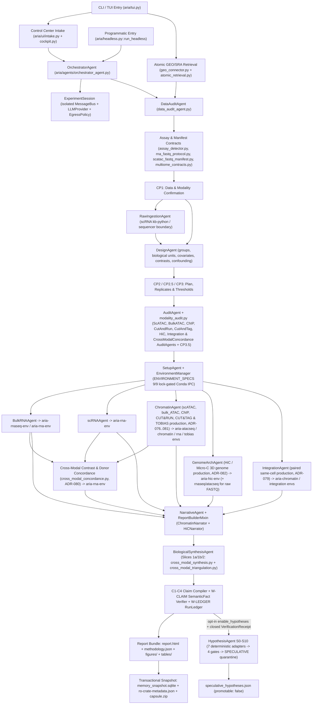

# Code Dependency & Contract Graph

`docs/architecture/code_graph.md` is the **single authoritative architectural impact and contract map** for ARIA. Consult this document before modifying shared agents, JSON IPC script schemas, claim/ledger governance, environment routing, or report/capsule serialization, and update it whenever a shared contract or dependency edge changes.

---

## 1. End-to-End Runtime & Governance Flow

---

## 2. Core Mechanical Invariants

| Invariant | Owning Modules | Non-Negotiable Contract | Primary Guards |
| :--- | :--- | :--- | :--- |
| **Zero Fabrication (`ADR-002` / `P-FAKE-GUARD`)** | `aria/scripts/*`, `aria/agents/*` | Unmeasured metrics stay `None` / `"not measured"`. Mock paths require explicit test flags; empty `AnnData()` or hash-derived numbers are forbidden. | `tests/test_no_fabrication_guard.py`, `tests/test_wnn_no_fabrication.py` |
| **Biological Neutrality (`ADR-011`)** | Core agents, narrators, `hypothesis/adapters/*` | Core logic and adapters contain zero hardcoded gene, TF, or pathway panels (technical species/mito prefixes and `human_markers` curation fallback are the sole documented exceptions). | `tests/test_v48_i9_cross_modal_hypotheses.py`, `tests/test_biological_synthesis.py` |
| **Prompt Boundary & Claim Compiler (`C1`)** | `aria/llm/prompt_boundary.py`, `aria/agents/narrative/claim_compiler.py` | Every untrusted input (question, filenames, labels, gene symbols, DB terms) enters LLMs inside a single escaped `<untrusted_data>` JSON envelope. `compile_public_claims` is the exclusive path into `report.html` and `methodology.json["claims"]`. | `tests/test_preprint_audit_c1_claim_boundary.py` |
| **Typed Semantic Fact Verification (`C2` / `W-CLAIM`)** | `narrative/types.py::SemanticFact`, `narrative/evidence_verifier.py` | Claims are verified against structured `EvidenceCard` numbers, entities/aliases, predicates, and polarity (rejecting negation inversions and absent entities). `compose_block_prose` renders structured claims deterministically, guaranteeing Claim 6 fail-closed monotone invariance across LLM providers. | `tests/test_preprint_audit_c2_semantic_facts.py`, `tests/test_preprint_audit_b3_multi_provider.py` |
| **Typed Run-Ledger Linkage (`C3` / `W-LEDGER`)** | `narrative/run_ledger.py`, `claim_compiler.py` | Every non-empty public result claim must resolve to an executed `analysis_run` (or allowlisted `derived_report_analysis`) node with provenance plus a typed `evidence_card` node. Unlinked or unexecuted claims are withheld opaquely. | `tests/test_preprint_audit_c3_publication_linkage.py`, `tests/test_render_ledger_e2e.py` |
| **Exact-Estimand Causal Licensing (`C4`)** | `claim_compiler.py::resolve_causal_estimand_license`, `narrative/validators.py` | Observational omics caps at `associative`. `causal_experimental` requires a unique structured contrast match in `design.causal_estimands` with `interventional=True`, `randomized=True`, and `confounding_verified=True`. | `tests/test_preprint_audit_c4_causal_estimands.py`, `tests/test_causal_guard.py` |
| **`SPECULATIVE` Quarantine Wall (`C7` / `ADR-057` / `ADR-072`)** | `aria/agents/hypothesis_agent.py`, `narrative/hypothesis/*` | Opt-in (`--hypotheses` / `enable_hypotheses=True`), runs last over verified `RunLedger` outputs only, enforces 4 deterministic gates, stamps `hypothesis://` non-promotable IDs, and asserts zero leakage into `methodology.json["claims"]` (`assert_no_speculative_promotion`). | `tests/test_hypothesis_quarantine.py`, `tests/test_v48_i9_cross_modal_hypotheses.py` |
| **Hermetic Stack Routing & Locks (`A5`, `ADR-082`)** | `utils/environment_specs.py`, `utils/environment_manager.py`, `utils/script_contracts.py`, `docker/Dockerfile.*` | `ENVIRONMENT_SPECS` is the sole stack registry (`rna`, `ingestion`, `rnaseq`, `atacseq`, `chromatin`, `tobias`, `integration`, `hic`, `benchmark` — **9/9 locked** with exact `.linux-64.lock` + `.pip.lock` verified by `environment_audit`, plus `Dockerfile.hic`). Every `run_in_stack` call has a `ScriptContract`. Missing scientific envs fail closed; `aria-env` is never substituted. | `tests/test_preprint_audit_a5_environment_contracts.py`, `tests/test_dispatchable_contracts.py`, `tests/test_env_lock_numpy_consistency.py`, `tests/test_docker_hermeticity.py` |
| **Honest Modality & Integration Tiers (`ADR-056` / `ADR-075`..`ADR-082`)** | `orchestrator_agent.py` (`MODALITY_VALIDATION`, `INTEGRATION_VALIDATION`, `CROSS_MODAL_CONCORDANCE_VALIDATION`), `agents/modality_audit.py` (`ScATACAuditAgent`, `BulkATACAuditAgent`, `ChIPAuditAgent`, `CutAndRunAuditAgent`, `CutAndTagAuditAgent`, `HiCAuditAgent`, `IntegrationAuditAgent`, `CrossModalConcordanceAuditAgent`), `utils/registry_integrity.py` | `MODALITY_VALIDATION` holds all **9/9** single-assay tiers at **`production`** (`bulk_RNA`, `bulk_RNA_raw`, `scRNA`, `scATAC`, `bulk_ATAC`, `ChIP`, `CUT_AND_RUN`, `CUT_AND_TAG`, `HiC`, with `TOBIAS` `differential_tf_footprinting` promoted to `production_associative`); `integration` and `cross_modal_concordance` never enter it. `INTEGRATION_VALIDATION` governs paired same-cell RNA+ATAC (`ADR-079`, `scope="paired_same_cell_rna_atac"`, `requires_ack=False`, `production_promoted=True`), while `CROSS_MODAL_CONCORDANCE_VALIDATION` (`ADR-080`, `level="production"`, `evidence_tier="associative"`, `scope="contrast_and_sample_matched_rna_atac_concordance"`, `requires_ack=False`, `production_promoted=True`) governs non-same-cell RNA $\times$ ATAC contrast & donor concordance (`bulk_RNA + bulk_ATAC` and unpaired cohort `scRNA + scATAC`), keeping diagonal single-cell manifold imputation blocked fail-closed. | `tests/test_registry_integrity.py`, `tests/test_docs_drift_guard.py`, `tests/test_modality_readiness.py`, `tests/test_epigenomics_chip_cutrun_cuttag_e2e.py`, `tests/test_hic_production_e2e.py`, `tests/test_integration_governance_adr079.py`, `tests/test_cross_modal_production_e2e.py` |

---

## 3. Shared Infrastructure & Front-Door Impact Matrix

| Module / Surface | Key Consumers | Impact & Risk Notes | Guard Tests |
| :--- | :--- | :--- | :--- |
| `aria/version.py` + `pyproject.toml` + `scripts/update_version_metadata.py` | Package version, `README.md` badge, `docs/release_notes_v{version}.md`, report `workflow_hash`, Docker image metadata | Single version source (`__version__`). PEP 621 dynamic version in `pyproject.toml` with upper ceilings on all core dependencies (`requires-python = ">=3.11"`). | `tests/test_packaging.py`, `tests/test_pytest_smoke.py::test_version_stamps_are_derived_from_single_source` |
| `aria/runtime/experiment_session.py` + `aria/bus/message_bus.py` + `aria/llm/provider.py` | `OrchestratorAgent`, `BaseAgent`, `EnvironmentManager`, `tui.py`, `headless.py`, `NarrativeAgent` | Per-experiment isolation (`A3` / `A6`): each run owns an isolated `MessageBus` (`bus_log.jsonl`), `LLMProvider.for_execution()` (`llm_usage.jsonl`, `temperature=0`, `seed=0` only on seed-capable backends), `EgressPolicy` (`ContextVar` + child subprocess env), and `cp35_acknowledged` state. | `tests/test_preprint_audit_a3_runtime_isolation.py`, `tests/test_preprint_audit_a6_reproducibility.py`, `tests/test_egress_governance.py` |
| `aria/tui.py` + `aria/ui/{cockpit,intake,render,clipboard,brand,scatac_manifest_editor}.py` + `aria/runtime/experiment_view.py` | Interactive CLI `aria`, `--classic-tui`, `--reproducible`, `--hypotheses` | Pure presentation over `experiment_view.build_snapshot` and checkpoint resolution. Session-aware clipboard (`SSH` safe). `experiment_view` inspects local files/published bus state only (never polls `conda` or triggers network egress). | `tests/test_cockpit_app.py`, `tests/test_cockpit_render.py`, `tests/test_experiment_view.py`, `tests/test_clipboard.py` |
| `aria/connectors/geo_connector.py` + `aria/utils/atomic_retrieval.py` | TUI/CLI GEO intake, `DataAuditAgent` | `E6` closed-world staging: downloads with bounded retry + SHA-256, safe archive extraction, atomic directory rename on complete `retrieval_manifest.json`, and multifactorial `sample_sheet` + `covariates` preservation (`B2`). | `tests/test_preprint_audit_e6_geo_sra_atomic.py`, `tests/test_preprint_audit_b2_confounding.py`, `tests/test_geo_atac_inference.py` |
| `aria/agents/data_audit_agent.py` + `utils/{assay_detector,rna_fastq_protocol,sequencer_formats,scatac_fastq_manifest,multiome_contracts,assay_contracts}.py` | `OrchestratorAgent` CP1, `RawIngestionAgent`, `DesignAgent`, `AuditAgent`, `BulkRNAAgent`, `IntegrationAgent` | Fails closed on BCL/POD5/FAST5 (`E1`), long-read RNA (`>=600 bp`), V(D)J TCR/BCR repertoire FASTQs, unmanifested asymmetric barcode+UMI FASTQs, and `n<2` inferential bulk contrasts (`ADR-075`); treats undeclared generic paired FASTQs as non-binding hints (`E2`); validates pooled plate (`pooled_plate_manifest`) & scATAC (`E5`) manifests; enforces `same_cell` barcode bijection for paired `.h5mu` (`I1`). | `tests/test_preprint_audit_e1_sequencer_boundary.py`, `tests/test_preprint_audit_e2_library_type.py`, `tests/test_preprint_audit_e5_scatac_manifest.py`, `tests/test_bulk_rna_raw_multiplatform_e2e.py`, `tests/test_v48_i1_paired_mudata_qc.py` |
| `aria/agents/design_agent.py` + `utils/{design_matrix,design_power}.py` | `BulkRNAAgent`, `scRNAAgent`, `ChromatinAgent`, `AuditAgent` | Distinguishes `groups` (all libraries) from `analysis_groups` (biological units after explicit `_repN`/`_rN` technical-replicate aggregation, `B1`), blocks perfectly confounded condition/covariate designs (`B2`), and forbids alphabetical reference selection (`P0-5`). | `tests/test_preprint_audit_b1_technical_replicates.py`, `tests/test_preprint_audit_b2_confounding.py`, `tests/test_explicit_contrast_gate.py`, `tests/test_benchmark_b1_design_governance.py` |
| `aria/memory/memory.py` + `narrative/ledger_export.py` + `narrative/reporting/*` | `NarrativeAgent`, `aria export`, `aria reproduce`, `aria diff` | `ReportBuilderMixin` (`ReportRenderMixin`, `ExecutiveSummaryMixin`, `MethodologyMixin`, `ReportSectionsMixin`) writes unique execution bundles (`exist_ok=False`), exports WAL-consistent single-experiment `memory_snapshot.sqlite`, emits `ro-crate-metadata.json`, and stages/verifies portable `capsule.zip` archives (`code_graph.md` + `envs/*.lock` + report artifacts). | `tests/test_report_builder_contract.py`, `tests/test_preprint_audit_a2_capsule.py`, `tests/test_ledger_export.py` |

---

## 4. Modality & Cross-Modal Pipelines

### 4.1 Bulk RNA-seq (`BulkRNAAgent` — Matrix & Universal Raw FASTQ `production`, `ADR-075`)
- **Orchestration & Universal Raw FASTQ Engine (`aria-rnaseq-env` / `docker/Dockerfile.rnaseq`):** `aria/agents/bulk_rna_agent.py` + `aria/utils/rna_fastq_protocol.py` routes four short-read bulk families across five `production` IPC scripts with `A4` `stage_manifest` resume:
  - Per-sample (`full_length`, `tag_3prime`, `tag_5prime`, `umi_bulk`): `rna_fastq_qc.py` (`fastp` SE/PE/multi-lane `E4`, poly(X)/poly(G) trimming, optional `--umi` extraction) -> `rna_align.py` (dynamic `_sa_index_nbases` STAR index auto-build, 2-pass `full_length` vs 1-pass soft-clip-preserving tag alignment) -> optional `rna_umi_dedup.py` (directional 1-Hamming `pysam` UMI graph collapse per `(chrom, strand, 5'-anchor)`) -> `rna_quantify.py` (`pysam` indexed/unindexed multi-contig fail-closed strandedness + `featureCounts`).
  - Multiplexed well-barcode + UMI plates (`pooled_plate_bulk`: BRB-seq, DRUG-seq, Prime-seq, QuantSeq-Pool, CEL-Seq2): `rna_starsolo_bulk.py` (`STAR --soloType CB_UMI_Simple --soloUMIdedup 1MM_Directional_UMItools`).
- **Statistical Core & Narrative (`aria-rna-env`):** `aria/scripts/rna_bulk_de.py` + `aria/scripts/rna_bulk/{contrasts,counts,deseq2,gtf_io,ora,plots,qc,transforms}.py`. Enforces total count-column/metadata correspondence (`B5`), sums explicit technical replicates prior to fit (`B1`), runs `pyDESeq2` with `lfcThreshold` inside the Wald test + apeGLM shrinkage + contrast-family BH-FDR (`0` diff on `deseq2.py`), exports `counts_cpm.tsv` and automatically suppresses `TPM` (`counts_tpm.tsv`) on end-tag/UMI protocols due to gene-length bias, links raw preprocessing to `ledger://bulk/preprocessing` (`C3`), and disables free-text LLM result prose (`F3`).
- **Thresholds:** Default `|log2FC| = 1.0` (`ADR-055`), changed only via explicit CP3 profile or `global_lfc`.
- **Guards:** `tests/test_bulk_rna_raw_multiplatform_e2e.py`, `tests/test_bulk_rna.py`, `tests/test_rna_bulk_de_contract.py`, `tests/test_preprint_audit_b4_no_name_fallback.py`, `tests/test_preprint_audit_b5_metadata_correspondence.py`, `tests/test_preprint_audit_e4_bulk_fastq_manifest.py`, `tests/test_preprint_audit_c1_h9_fastq_e2e.py`.

### 4.2 Single-Cell RNA-seq (`scRNAAgent` — `production`; Trajectory & LIANA `beta`)
- **Orchestration:** `aria/agents/scrna_agent.py` facade over `aria/agents/scrna/{agent,qc,annotation,de,pseudobulk,advanced,_base}.py`; raw FASTQ/MEX pre-pipeline via `RawIngestionAgent` + `utils/raw_ingestion.py::resolve_kb_chemistry` (`rna_kb_count.py` per-sample quantification across 3', 5' `10X_5P`/`10X_5P_PE`, `SMARTSEQ2/3`, `BDWTA`, `CELSEQ2`, `SPLIT-SEQ`, `VISIUM`, and custom `bc:umi:cdna` + explicit identity-preserving union `E3` in `aria-ingestion-env`).
- **Core Scripts (`aria-rna-env`):** `rna_qc_filter.py` (MAD/ambient/doublet QC), `rna_integration.py` + `utils/integration_qc.py` (Harmony + batch/cluster silhouette overcorrection red-flags), `rna_clustering.py` (PCA/kNN/Leiden), `rna_annotation.py` (CellTypist + disclosed marker fallback), `rna_de_markers.py` (exploratory cluster markers), `rna_pseudobulk_de.py` (donor-level `pyDESeq2` reusing `_run_deseq2`, pre-registered per-cluster/global BH-FDR `ADR-015`, paired donor blocking `B3`), `rna_pathway_per_cluster.py`, `rna_trajectory.py` (PAGA + root-gated DPT), `rna_cell_communication.py` (LIANA).
- **Narrative:** `narrative/narrators/scrna.py` + `narrative/scrna/{_common,text,tables,figures}.py` behind `_narrative_scrna.py`.
- **Guards:** `tests/test_scrna.py`, `tests/test_scrna_agent_contract.py`, `tests/test_narrative_scrna_contract.py`, `tests/test_pseudobulk_gate.py`, `tests/test_preprint_audit_e3_scrna_per_sample.py`, `tests/test_cellcomm_contract.py`.

### 4.3 Chromatin & Epigenomics: scATAC (`ADR-076`), Bulk ATAC (`ADR-077`), TOBIAS (`ADR-078`), ChIP / CUT&RUN / CUT&TAG (`ADR-081`) — All `production`
- **Orchestration & Readiness (`ScATACAuditAgent`, `BulkATACAuditAgent`, `ChIPAuditAgent`, `CutAndRunAuditAgent`, `CutAndTagAuditAgent`):** `aria/agents/chromatin_agent.py` + `chromatin_helpers.py` + `_narrative_chromatin.py` + `narrative/narrators/chromatin.py` + `utils/{scatac_cohort_union,seacr_idr,epigenomic_spikein_de}.py`. All 5 chromatin assays are `production` (`green`/`auto` for exploratory profiling or `n>=3` IP/biological-replicate contrasts — excluding Input/IgG control rows from biological IP replicate counts; `yellow`/`requires_ack` for `n==2` low-power designs or ChIP contrasts without Input/IgG controls; `red`/`blocked` for `n<2`, batch-confounded contrasts, or single-cell barcoded FASTQs misrouted to bulk chromatin).
- **Raw & Matrix Scripts:**
  - `aria-atacseq-env` (`docker/Dockerfile.atacseq`, `validated`): `atac_align.py` (`production`: SE/PE/multi-lane `bwa-mem2` across `bulk_ATAC`, `ChIP`, `CUT_AND_RUN`, `CUT_AND_TAG`, assay-aware `remove_duplicates=False` default for `CUT_AND_TAG`, heterologous `spikein_*` read counting, chimeric `-SP5M` mode for `HiC`, and `A4` `stage_manifest`), `chromatin_scatac_align.py` (`production`: multi-library, multi-lane `L001..L00N`, platform presets `10x_atac`/`10x_multiome_atac`/`sci_atac`/`share_seq`/`surecell`/`custom`, auto direct/RC barcode-whitelist detection failing closed on `barcode_whitelist_mismatch`, `A4` `stage_manifest`).
  - `aria-chromatin-env` (`docker/Dockerfile.chromatin`, `validated`): `chromatin_fragments_to_matrix.py` (`production`: `snapatac2` fragments -> peak matrix with 100% offline `ARIA_AIR_GAPPED=1` local `.fai`/FASTA support, multi-fragment union, `obs` preservation, and `A4` resume), `chromatin_merge_matrices.py` (`production`: sweep-line genomic-overlap consensus peak union across multi-file `.h5mu`/`.h5ad` cohorts, `ADR-043`), `chromatin_qc.py` (`production`: scATAC + 100% local `pysam`+`bedtools`+GTF bulk ENCODE/epigenomic QC for FRiP, TSSe, `dup_rate`, `NRF`, `PBC1`, `PBC2`, strand cross-correlation `NSC`/`RSC`, `ip_control_jsd`, and subnucleosomal `<120 bp` vs mononucleosomal `140–250 bp` banding), `chromatin_lsi_clustering.py` (TF-IDF + depth-filtered SVD/LSI + Leiden), `chromatin_peaks.py` (`production`: SE/PE `MACS3` narrow/broad, Meers et al. 2019 `SEACR` `stringent`/`relaxed` with IgG `norm`/`non` or top-`q`, `call_broad_domains` megadomains, Li et al. 2011 Gaussian-copula EM `IDR` consensus, normalized BigWigs, blacklist filtering, and `A4` resume), `chromatin_peak_counts.py` (`production`: `bedtools coverage` integer + `CPM` + optional spike-in scaled matrices, excluding Input/IgG controls from IP matrix columns, `A4` resume), `chromatin_motifs.py` (offline MEME v4 motif enrichment), `chromatin_regulatory.py` (Signac-calibrated `(GC, accessibility)` trans-null `peak2gene_core.py` cis links + caveated `gene_scores`).
  - `aria-rna-env`: `chromatin_diffacc.py` (`production`: donor-aware scATAC pseudobulk DA via shared `_run_deseq2` core + per-comparison `full_results_csv`), `chromatin_bulk_diffacc.py` (`production`: replicate-gated `pyDESeq2` DA/DB across `bulk_ATAC`, `ChIP`, `CUT_AND_RUN`, `CUT_AND_TAG`, routing heterologous spike-in counts/scales through `utils/epigenomic_spikein_de.py` with technical-replicate sum-first `size_factors` and `0` diff on `deseq2.py`), `chromatin_peak_annotation.py` & `chromatin_peak_ora.py` (`production` across `scATAC`, `bulk_ATAC`, `ChIP`, `CUT_AND_RUN`, `CUT_AND_TAG`), `chromatin_figure_bulk.py` (`production`: dual PNG+SVG `bulk_atac_pca` and `bulk_atac_qc_summary`).
  - `aria-tobias-env` (`docker/Dockerfile.tobias`, `validated`, `ADR-078`): `chromatin_footprint_tobias.py` (`production`: `TOBIAS` Tn5-corrected footprinting across multi-sample `scATAC` fragments and `bulk_ATAC` BAM/CRAM cohorts; replicate-level Welch, paired-donor, or batch-adjusted OLS + stratified label permutations + BH-FDR when `n>=3` biological replicates exist, `descriptive_only` on pooled/confounded runs `B7`; `A4` `stage_manifest` resume; dual PNG+SVG `footprint_volcano`; live `footprint_rna_concordance`).
- **Narrative & Ledger (`C3`):** `ledger://chromatin/scatac_preprocessing`, `ledger://chromatin/bulk_atac_preprocessing` (all 4 bulk chromatin assays), `ledger://chromatin/differential_tf_footprinting`, and modality-aware `peak_annotation` / `peak_ora` blocks.
- **Guards:** `tests/test_seacr_idr_spikein.py`, `tests/test_epigenomics_chip_cutrun_cuttag_e2e.py`, `tests/test_scatac_production_multiplatform_e2e.py`, `tests/test_bulk_atac_production_e2e.py`, `tests/test_tobias_production_e2e.py`, `tests/test_chromatin_footprint_tobias.py`, `tests/test_chromatin_footprint_governance.py`, `tests/test_scatac_cohort_union.py`, `tests/test_chromatin_scatac_align.py`, `tests/test_chromatin_fragments_to_matrix.py`, `tests/test_orchestrator_scatac_dispatch.py`, `tests/test_bulk_atac_v47.py`, `tests/test_bulk_atac_peak_counts.py`, `tests/test_bulk_atac_diffacc.py`, `tests/test_preprint_audit_b7_footprint_inference.py`, `tests/test_benchmark_scatac_concordance.py`, `tests/test_consensus_pseudobulk_da.py`.

### 4.3b 3D Genome Architecture: Hi-C / Micro-C (`GenomeArchAgent` — `production`, `ADR-082`)
- **Orchestration, Environment & Readiness (`HiCAuditAgent`):** `aria/agents/genome_arch_agent.py` + `envs/aria-hic-env.{yml,linux-64.lock,pip.lock}` + `docker/Dockerfile.hic` (`ARIA_IMAGE_VALIDATION=validated`). Auto-dispatches (`green`) single/cohort profiling or `n>=3` replicate differential 3D contrasts, requires `CP3.5` acknowledgement (`yellow`) for `n==2` low-power contrasts or raw FASTQs missing a local reference FASTA, and blocks (`red`) `n<2` contrasts, confounded designs, or misrouted single-cell FASTQs.
- **Computational Stack (`stack="hic"`, 5 `production` `ScriptContract`s):**
  - `hic_preprocess.py`: universal intake from `.pairs(.gz)`, `.hic` (`hic2cool`), chimeric BAM (`pairtools parse -> sort -> dedup`), or single-resolution `.cool` into multi-resolution `.mcool` (`cooler cload pairs` + `cooler zoomify --balance`) with `A4` `stage_manifest.json` resume; raw paired Hi-C FASTQs align first via `rna_fastq_qc.py` + `atac_align.py` (`hic_chimeric=True`, `bwa-mem2 mem -SP5M`).
  - `hic_inspect.py` & `hic_qc_and_balance.py`: exact `clr.pixels()` cis/trans contact summation (zero constant fallbacks), ICE balancing (`cooler.balance_cooler`), power-law $P(s)$ decay slope, and multi-replicate distance-stratified HiCRep `SCC`.
  - `hic_topology.py`: GC-content / GTF gene-density phased `cooltools.eigs_cis` A/B compartments (`pc1_validated=True`), Crane et al. (2015) `insulation` TADs + window calibration, `expected_cis` + `dotfinder.dots` chromatin loops with GTF TSS anchor annotation, and empirical-Bayes variance-moderated OLS multi-replicate `differential_3d` (`A_to_B` / `B_to_A` switches + $\Delta\text{Insulation}$ + BH-FDR, downgrading `n < 3` to `descriptive_only`).
  - `hic_figure.py`: dual 300-DPI PNG + editable SVG publication figures (`contact_decay_scc`, `contact_saddle`, `compartment_insulation_track`, `differential_compartments`).
- **Narrative, Ledger & Hypothesis Quarantine (`C1`–`C4`):** `narrative/narrators/hic.py` (`HiCNarrator`), `_HIC_ANALYSES` (`ledger://hic/{preprocessing,qc,compartments,tads,loops,differential_3d}`), and `narrative/hypothesis/adapters/hic.py` (`hic_evidence`, `HIC_LOOP_ASSOCIATIVE`).
- **Guards:** `tests/test_hic_production_e2e.py`, `tests/test_hic_dispatch_gate.py`, `scripts/run_adr082_hic_validation.py`.

### 4.4 Paired Same-Cell Multiome Integration (`IntegrationAgent` — `production`, `ADR-079`; V48 `I1`–`I8`)
- **Scope & Gates (`ADR-064`, `ADR-071`, `ADR-079`, `ADR-080`):** `INTEGRATION_VALIDATION` (`level="production"`, `scope="paired_same_cell_rna_atac"`, `production_promoted=True`, `requires_ack=False`). Covers verified paired `.h5mu`, Cell Ranger ARC `.h5`/MEX, raw Multiome FASTQs (`multiome_fastq_manifest`), and multi-donor paired cohorts (`cohort_merge_required=True`) with batch-aware WNN. Unpaired split `scRNA + scATAC` diagonal manifold/cell imputation (GLUE / Seurat bridge / MultiVI), `scRNA + ChIP`, ATAC-only `.h5mu`, mixed paired+unpaired containers, and incomplete or non-same-cell FASTQ manifests fail closed in `IntegrationAgent` (`enforce_same_cell_integration_gate`) while preserving single-assay lanes and routing contrast/donor-matched `bulk_RNA + bulk_ATAC` or unpaired cohort `scRNA + scATAC` studies to `cross_modal_concordance.py` (`ADR-080`). `IntegrationAuditAgent` dispatches clean paired inputs automatically and requires CP3.5 acknowledgement (persisted in `ARIAMemory`) only for measured risks (`< 200` shared cells, partial barcode overlap, condition/batch-confounded cohorts).
- **Computational Stack:**
  - `integration_assemble_multiome.py` + `integration_merge_cohort.py` (`ADR-079`): same-cell intake from ARC `.h5`/MEX, shared/ARC-whitelist/bijection-mapped paired matrices, fragments+peaks quantification, or manifested raw Multiome FASTQs (`kb` + `chromap`), and multi-donor sparse CSR cohort union onto sweep-line consensus peaks with `{sample_id}#{barcode}` (`ledger://integration/preprocessing`, executed only when a `.h5mu` artifact is recorded).
  - `integration_paired_qc.py` (`stack="chromatin"`, `ADR-064`, `ADR-079`): `utils/mudata_io.py` (`read_h5mu_paired` across `.h5mu`, ARC `.h5`, and ARC MEX; `h5py` `/obs`-only bijective `join_obs_labels_from_h5ad`), measured joint RNA+ATAC QC, `A4` `stage_manifest` resume, and atomic post-QC `.h5mu` enforced across all downstream stages.
  - `integration_wnn.py` + `integration_wnn_diagnostics.py` (`stack="chromatin"`, `ADR-065`–`066`, `ADR-079`): deterministic Seurat-v5-concordant WNN (`ARI=0.958`), optional donor/batch-aware Harmony harmonization on `X_pca` + `X_lsi` (`harmonypy` `0.2.0`/`2.0.0`) with WNN batch iLISI, before/after batch silhouettes, and `assess_integration_quality` overcorrection checks, `A4` `stage_manifest` resume, and `utils/wnn_diagnostics.py` 5-axis anti-degradation guardrail ("lens, not replacement").
  - `integration_mofa.py` (`stack="integration"`, `ADR-067`, `ADR-079`): deterministic `mofapy2` decomposition + closed-form Gaussian posterior subsample projection + quantitative sequencing-depth/cell-cycle AND one-way ANOVA $\eta^2$ batch/donor factor screening conditioned on `condition_col` (`muon.tl.mofa` concordant, `|r|=0.973`) + `A4` `stage_manifest` resume.
  - `integration_peak2gene.py` (`stack="integration"`, `ADR-068`, `ADR-079`): shared `utils/peak2gene_core.py` with bidirectional UCSC/Ensembl contig canonicalization, `.fai` GC matching, BLAS-vectorized trans-chromosomal `(GC, accessibility)` null (`Signac::LinkPeaks` `Jaccard=0.867`), `0` false discoveries on barcode-permuted multi-donor null controls, and `A4` `stage_manifest` resume.
  - `integration_eregulons.py` (`stack="integration"`, `ADR-069`, `ADR-079`): `utils/eregulon_core.py` fixed-500bp motif scan (`snapatac2_rust` / `aria_numpy_dp`), GC-quintile CMH cistrome enrichment, depth partial correlations, `5x5` `(expr, prevalence)` finite-population null, pre-collapse BH-FDR, weighted GSEA pruning, paralog flags, rank AUCell (`17.99x` edge fold-enrichment vs `SCENIC+ 1.0.0`), and `A4` `stage_manifest` resume.
- **Narrative & Figures (`ADR-070`, `ADR-079`):** `narrative/synthesis/cross_modal_triangulation.py` (non-circular `Cross-Modal Evidence Graph` stamping `shared_upstream=["peak_to_gene"]`), `narrative/narrators/integration.py` (`IntegrationNarrator` including `multiome.preprocessing`, Harmony WNN mixing/overcorrection, and MOFA+ batch confounding disclosures), `_narrative_integration.py` (4 dual 300-DPI PNG + editable SVG figures and CSV table staging), and `_INTEGRATION_ANALYSES` in `run_ledger.py`.
- **Associative boundary:** `peak_to_gene`, `eregulons`, and MOFA+ factors are `production_associative` (zero causal claims); `HypothesisAgent` `S10` keeps mechanistic extrapolation quarantined behind `SPECULATIVE`.
- **Guards:** `tests/test_v48_i{1,2,3,4,5,6,7,8}_*.py`, `tests/test_integration_agent.py`, `tests/test_multiome_universal_intake.py`, `tests/test_integration_governance_adr079.py`, `tests/test_multiome_production_e2e.py`, `scripts/run_adr079_multidonor_multiome_validation.py`.

### 4.5 Non-Same-Cell Cross-Modal Contrast & Sample/Donor Concordance (`ADR-080`, Closing `ADR-028 Slice 2`)
- **Scope & Gates (`ADR-028`, `ADR-080`):** `CROSS_MODAL_CONCORDANCE_VALIDATION` (`level="production"`, `evidence_tier="associative"`, `scope="contrast_and_sample_matched_rna_atac_concordance"`, `production_promoted=True`, `requires_ack=False`) + `CrossModalConcordanceAuditAgent` (`green`/`auto` on aligned RNA $\times$ ATAC contrasts; `yellow`/`requires_ack` on `n == 2` low-power contrasts; `red`/`blocked` on diagonal cell imputation requests `diagonal_cell_imputation_not_validated`, incompatible denominators, `n < 2` contrasts, or confounded covariates). Automatically dispatched by `OrchestratorAgent._run_cross_modal_concordance` when both RNA (`BulkRNAAgent` or `scRNAAgent` pseudobulk) and chromatin (`ChromatinAgent` `bulk_ATAC` or `scATAC` pseudobulk) results exist and paired same-cell `IntegrationAgent` has not already run.
- **Statistical & Figure Engine (`stack="rna"`, `aria/utils/cross_modal_concordance.py` + `aria/scripts/cross_modal_concordance.py`):**
  - Contrast canonicalization (`A_vs_B` vs reversed `B_vs_A` negates ATAC `log2FC`, motif enrichment direction, and `TOBIAS` footprint change while stamping `atac_sign_flipped=True`; refuses incompatible denominators `A_vs_B` vs `A_vs_C`).
  - **Layer A:** 4-quadrant cis DE $\times$ DA concordance (`<= 100 kb` cis + `<= 2 kb` promoter subset; all-tested peak background when GTF TSS coordinates are available), 2×2 directional Fisher exact test, 2×2 co-significance enrichment Fisher exact test, and continuous Spearman $\rho$ / Pearson $r$.
  - **Layer B:** TF motif (`JASPAR2024`, supporting both `::up_in_<level>` and `_up`/`_down` group formats) + non-descriptive `TOBIAS` differential footprint $\times$ cognate TF RNA triangulation (`::` dimer splitting, `paralog_motif_ambiguity` flagging, zero hardcoded TF lists).
  - **Layer C:** Functional pathway intersection (`RNA ORA` $\cap$ `ATAC peak_ora`) with Jaccard overlap index.
  - **Layer D:** Sample/donor-matched cis peak–gene correlation (`N >= 6` shared biological units, `log2(CPM + 1)`, pooled sample-label permutation BH-FDR + independent held-out permutation diagnostic; honest skips `insufficient_matched_biological_units` / `unmatched_sample_namespaces`).
  - Emits `A4` `stage_manifest.json`, 4 CSV supplements (`cross_modal_de_da_concordance.csv`, `cross_modal_tf_triangulation.csv`, `cross_modal_pathway_overlap.csv`, `cross_modal_sample_matched_links.csv`), and dual 300-DPI PNG + editable SVG `cross_modal_starburst`.
- **Synthesis, Ledger & Reporting (`C3` / `C4`):** `aria/agents/narrative/synthesis/cross_modal_synthesis.py` (`BiologicalSynthesisAgent` Slice 2: engine-backed + deterministic in-memory fallback, 100% `W-CLAIM` and zero-causal-verb compliant), `ledger://cross_modal/concordance` (`run_ledger.py`), and `NarrativeAgent` QC summary row, figure/table staging, and HTML-safe Methods paragraph.
- **Guards:** `tests/test_cross_modal_concordance_core.py`, `tests/test_cross_modal_synthesis_and_narrative.py`, `tests/test_cross_modal_production_e2e.py`, `scripts/run_adr080_cross_modal_concordance_validation.py`.

### 4.6 Opt-In `HypothesisAgent` (`S0`–`S10`, `ADR-057`, `ADR-072`, `ADR-080`..`ADR-082`)
- **Architecture:** `aria/agents/hypothesis_agent.py` + `aria/agents/narrative/hypothesis/{types,adapters,proposer_llm,grounding,gates,caveats,devils_advocate,ranking,quarantine,verification,report_section}.py`.
- **Adapters (Pure, Zero-LLM, 7 Total):** `bulk_rna`, `scrna`, `scatac` (`motif_enrich`, `gene_activity`, `peak2gene`, and inferential `footprint_score` with `FOOTPRINT_ASSOCIATIVE`), `bulk_atac` (`motif_enrich` and inferential `footprint_score` across `bulk_ATAC`, `ChIP`, `CUT_AND_RUN`, `CUT_AND_TAG`), `hic` (`ADR-082`: `hic_loop_anchor` named loop-anchor genes stamped with `HIC_LOOP_ASSOCIATIVE`), `integration` (`S10`: `peak_to_gene`, candidate `eregulons`, active non-excluded `shared` `mofa` RNA loadings with `direction="na"`, and `wnn` guardrail caveats), and `cross_modal` (`ADR-080`: `cross_modal_tf`, `cross_modal_cis_pair`, and `cross_modal_donor_link` stamped with `CROSS_MODAL_UNPAIRED_COHORT`).
- **Non-Circular Lineage & 4 Gates:** `EvidenceSignal.independence_key` collapses dependent paired cis representations (`scATAC` `peak2gene` + `integration` `peak_to_gene` + `integration` `eregulons`) and shared chromatin TF lineages (`chromatin_tf_lineage::<tf>` across single-assay chromatin and `cross_modal_tf`) into `1` independent line in `ranking.py`. Every candidate must pass `VerificationReceipt`, entity/direction `grounding`, `falsifiability` + non-causal `language` lint, and `devils_advocate` confound ownership before entering `speculative_hypotheses.json` (`promotable: false`).
- **Guards:** `tests/test_hypothesis_*.py`, `tests/test_v48_i9_cross_modal_hypotheses.py`, `tests/test_cross_modal_synthesis_and_narrative.py`.

---

## 5. Preprint Evidence Freeze & Benchmark Architecture

- **Freeze Engine:** `aria/benchmarks/preprint_freeze.py` + `scripts/run_preprint_freeze_{inventory,lane}.py` -> `docs/benchmark_results/preprint_v1/` (`inventory.json` + `receipts/*.json` + `claim_1..5/`). External multi-replicate bulk ATAC R concordance & permutation null live in `aria/benchmarks/bulk_atac_concordance.py` + `scripts/run_bulk_atac_concordance.py` -> `docs/benchmark_results/bulk_atac/adr077_multireplicate_r_concordance.json`, `TOBIAS` replicate-inference R concordance + live `TOBIAS 0.17.3` benchmark live in `aria/benchmarks/tobias_footprint_concordance.py` + `scripts/run_tobias_footprint_concordance.py` -> `docs/benchmark_results/bulk_atac_footprint/adr078_tobias_replicate_concordance.json`, paired multi-donor 10x Multiome validation lives in `scripts/run_adr079_multidonor_multiome_validation.py` -> `docs/benchmark_results/multiome_concordance/adr079_multidonor_multiome_validation.json`, 10-donor non-same-cell cross-modal contrast & donor concordance validation lives in `scripts/run_adr080_cross_modal_concordance_validation.py` -> `docs/benchmark_results/multiome_concordance/adr080_cross_modal_concordance_validation.json`, epigenomic ChIP/CUT&RUN/CUT&Tag SEACR + Copula IDR + Bioconductor `DESeq2` spike-in concordance validation lives in `scripts/run_adr081_epigenomics_validation.py` -> `docs/benchmark_results/epigenomics/adr081_chip_cutrun_cuttag_validation.json`, and 3D genome Hi-C/Micro-C validation lives in `scripts/run_adr082_hic_validation.py` -> `docs/benchmark_results/hic/adr082_hic_3d_genome_validation.json`.
- **Hash Binding:** `_source_snapshot_hash` hashes `git ls-files --stage` excluding only `docs/benchmark_results/preprint_v1/`. Committing evidence inside `preprint_v1/` preserves receipt validity; modifying any tracked file outside `preprint_v1/` marks receipts `stale_receipt` until regenerated from a clean checkout.
- **Guards:** `tests/test_preprint_freeze_inventory.py`, `tests/test_public_artifacts_no_absolute_paths.py`, `tests/test_preprint_audit_q1_doc_claims.py`, `tests/test_preprint_audit_c{1,2,3,4,5}_*.py`, `tests/test_benchmark_*.py`.
