# HypothesisAgent & The `SPECULATIVE` Quarantine Architecture (`S0`–`S10`)

`HypothesisAgent` (`aria/agents/hypothesis_agent.py` and `aria/agents/narrative/hypothesis/`) is ARIA's opt-in mechanistic hypothesis engine (`ADR-057`, `ADR-072`). It generates rival, falsifiable biological hypotheses grounded exclusively in a run's verified structured outputs while enforcing a **mechanical quarantine wall** so speculative ideas can never leak into or masquerade as established public findings.

---

## 1. Non-Negotiable Governance Rules

1. **Strictly Opt-In (`OFF` by default):** `HypothesisAgent` runs only when the user passes `aria --hypotheses`, toggles `Hypotheses: on` in the Control Center intake, or passes `enable_hypotheses=True` in `run_headless`. When off, zero proposer calls occur and no speculative HTML or JSON artifact is emitted.
2. **Downstream of Verified Public Governance (`VerificationReceipt`):** Before any LLM proposal call, `_speculative_verification_state` verifies that `W-CLAIM` (`claim_verification.status == "passed"`) and `W-LEDGER` (`n_violations == 0`) succeeded on the report's public claims. If public verification failed or was withheld, `HypothesisAgent` aborts fail-closed with `0` LLM calls and renders a transparent withheld banner.
3. **Zero Hardcoded Biology (`ADR-005` / `ADR-011`):** None of the 5 evidence adapters contain hardcoded gene, transcription factor, or pathway lists. Every candidate entity is extracted dynamically from the executed `RunLedger` outputs of the current dataset.
4. **Mechanical Quarantine (`assert_no_speculative_promotion`):** Every accepted hypothesis is assigned a batch-unique `hypothesis://<slug>` identifier (`promotable: false`). `SPECULATIVE` is absent from `claim_compiler.TIER_ORDER`, and `assert_no_speculative_promotion` raises a hard error if any public claim in `methodology.json["claims"]` cites a `hypothesis://` node or carries a speculative tier.

---

## 2. End-to-End Pipeline

```mermaid
flowchart LR
    LEDGER["Verified RunLedger + Agent Findings"] --> ADAPTERS["5 Pure Deterministic Adapters (Zero LLM)"]
    ADAPTERS --> SIGNALS["Bounded EvidenceSignal Set (signal_id + context + independence_key)"]
    RECEIPT["Closed VerificationReceipt (W-CLAIM + W-LEDGER)"] --> GATE0{"Receipt Valid?"}
    SIGNALS --> GATE0
    GATE0 -->|No| WITHHELD["Withhold Section (0 LLM calls)"]
    GATE0 -->|Yes| PROPOSER["LLMProposer (temp=0, adaptive token retry)"]
    PROPOSER --> G1["Gate 1: Entity, Direction & Non-Vacuity Grounding"]
    G1 --> G2["Gate 2: Falsifiable Experiment & Non-Causal Language Lint"]
    G2 --> G3["Gate 3: Devil's Advocate Caveat Ownership"]
    G3 --> RANK["Code-Owned Lineage Ranking + Competing Rivals"]
    RANK --> QUAR["Quarantine (hypothesis:// IDs, promotable: false)"]
    QUAR --> OUT["speculative_hypotheses.json + Quarantined Report Appendix"]
```

---

## 3. Five Deterministic Evidence Adapters (`adapters/`)

| Adapter | Modality / Stack | Audited `RunLedger` Sources | Emitted `EvidenceSignal` Highlights |
| :--- | :--- | :--- | :--- |
| `bulk_rna.py` | Bulk RNA-seq | `ledger://bulk_rna/differential_expression`, `ora`, `gsea` | Contrast-scoped DE genes (`log2FC`, `padj`, up/down) and enriched pathways; inherits low-power and batch caveats. |
| `scrna.py` | scRNA-seq | `ledger://scRNA/pseudobulk_de`, `ora`, `cell_communication`, `trajectory` | Donor-aware pseudobulk DE genes, cluster ORA terms, exploratory LIANA ligand-receptor pairs, and root-gated trajectory signals. |
| `scatac.py` | scATAC-seq | `ledger://chromatin/differential_accessibility`, `motif_enrichment`, `regulatory_peak2gene`, `footprinting` | Replicate-gated DA peaks/genes, enriched TF motifs (`MOTIF_NOT_BINDING`), cis `peak2gene` links (`PEAK2GENE_ASSOCIATIVE`), and footprint candidates. |
| `bulk_atac.py` | Bulk ATAC-seq | `ledger://chromatin/bulk_differential_accessibility`, `peak_ora`, `motif_enrichment`, `footprinting` | Replicate-gated bulk DA loci, annotated peak ORA terms, motif enrichments, and replicate-aware/descriptive `TOBIAS` footprint signals. |
| `integration.py` (`S10`) | Paired 10x Multiome | `ledger://integration/peak_to_gene`, `eregulons`, `mofa` (+ `wnn` guardrail status) | Top cis `peak_to_gene` genes (`max 20`, peak coordinate in `context`), non-composite candidate `eregulon` TFs (`max 10`) + non-self leading-edge targets (`max 3/TF`, `direction="na"`), and active non-excluded `shared` `MOFA+` RNA loadings (`max 3x5`, `direction="na"` honoring latent sign indeterminacy $Z W^\top = (-Z)(-W)^\top$). |

---

## 4. Non-Circular Cross-Modal Lineage (`independence_key`)

In paired 10x Multiome runs, `integration_eregulons` consumes `integration_peak2gene` BH-FDR cis links on the same cell universe, while co-run `ChromatinAgent` (`scATAC`) may also emit `peak2gene` signals. Counting those three citations as independent lines of evidence would be circular double-counting (`ADR-070`, `ADR-072`).

ARIA solves this in code (`types.py`, `report_section.py::gather_evidence`, `ranking.py::_rank_basis`) — never trusting LLM self-tallies:
- Co-run `scATAC` `peak2gene`, `integration` `peak_to_gene`, and `integration` `eregulons` carry `independence_key="paired_cis_regulatory"`.
- `ranking.py` collapses all cited signals sharing a non-empty `independence_key` into **one** `("lineage", "paired_cis_regulatory")` independent line and takes the `max` normalized effect across the group.
- Active shared `MOFA+` RNA loadings carry `independence_key="paired_mofa_latent"`, and independent single-assay differential contrasts (`RNA DE`, `ATAC DA`) retain distinct contrast contexts, legitimately increasing `n_independent_lines` only when genuinely distinct analytical axes converge.

---

## 5. The Four Deterministic Gates

Every candidate hypothesis returned by `LLMProposer` is evaluated independently; rejected candidates are logged with explicit gate reasons and never rendered as accepted hypotheses:

1. **Receipt & Input Integrity Gate (`verification.py`):** Requires a closed, violation-free `VerificationReceipt` over the run's public report claims and non-empty audited `EvidenceSignal`s.
2. **Entity, Polarity & Prose Grounding Gate (`grounding.py`):**
   - Requires $\ge 1$ grounded biological entity and $\ge 1$ valid `signal_id` citation (non-vacuity).
   - Verifies that every named entity in **both** the structured `entities` list and generated prose fields (`mechanism`, `perturbation`, `expected_direction`, `refutation_criterion`, `simpler_explanation`) exists in the audited `EvidenceSignal` set with concordant direction (`up`/`down`).
3. **Falsifiability & Non-Causal Language Gate (`gates.py`):**
   - Requires a concrete experimental test specifying `perturbation`, `readout`, `expected_direction`, and an explicit `refutation_criterion` that would falsify the hypothesis.
   - Word-boundary language lint blocks causal/proof assertions (`proves`, `demonstrates causation`, `confirms direct regulation`, etc.).
4. **Devil's Advocate Caveat Ownership Gate (`caveats.py`, `devils_advocate.py`):**
   - Collects all structured caveats attached to the signals cited by a candidate (including `low_power`, `motif_not_binding`, `peak2gene_associative`, `paralog_motif_ambiguity`, `depth_confounded`, `mofa_latent_associative`, and `wnn_guardrail_degraded`) and verifies that the candidate's caveats/simpler-explanation explicitly acknowledge each active confound.

---

## 6. Outputs & Verification Anchors

- **Artifact:** `<report_dir>/speculative_hypotheses.json` (`promotable: false`, `input_evidence_sha256`, accepted hypotheses with `hypothesis://` IDs, `competing_with` rival links, and per-gate rejection counts).
- **Tests:** `tests/test_hypothesis_*.py` (`S0`–`S9`) and `tests/test_v48_i9_cross_modal_hypotheses.py` (`S10`, `188/188` unit + red-team + real `GSE278576` `hc11` Multiome E2E).
