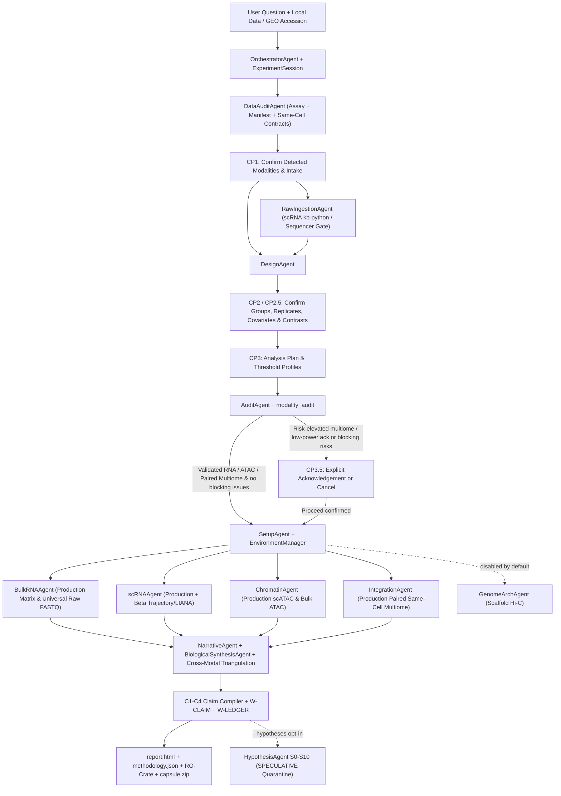

# Architecture Overview

ARIA is not a loose collection of bioinformatics scripts or a free-form LLM wrapper. It is a **supervised, evidence-governed control plane** around deterministic omics execution:

1. parse the biological question inside an isolated `<untrusted_data>` boundary;
2. audit input files, manifests, and multiome barcode contracts;
3. confirm experimental design, biological units, covariates, and contrasts before compute;
4. dispatch deterministic scientific scripts inside lock-gated Conda stacks via JSON IPC;
5. reconcile planned vs executed analyses in a typed `RunLedger` and compile public claims through `C1–C4` semantic/causal verifiers;
6. publish a self-contained HTML report, `methodology.json`, RO-Crate metadata, and a portable reproducibility capsule — plus, only when explicitly opted in, a mechanically quarantined `SPECULATIVE` hypothesis appendix.

---

## Main Agent & Governance Flow

The standalone Mermaid source is stored in [aria_overview.mmd](../diagrams/aria_overview.mmd). For module-level contracts, high-risk dependency edges, and test anchors, consult the [Code Dependency & Contract Graph](code_graph.md).

---

## Core Components

| Component | Responsibility |
| :--- | :--- |
| `OrchestratorAgent` | Owns checkpoint progression (`CP1`–`CP5`), `MODALITY_VALIDATION` / `INTEGRATION_VALIDATION` gates, and agent dispatch. |
| `ExperimentSession` | Isolates per-run `MessageBus`, `LLMProvider` usage logs, `EgressPolicy` (`ARIA_AIR_GAPPED`), and `cp35_acknowledged` state. |
| `DataAuditAgent` | Content-based assay detection, `E6` GEO manifest verification, scATAC multi-library manifests (`E5`), and paired `.h5mu` same-cell contract checks (`I1`). |
| `DesignAgent` | Confirms groups, explicit biological units vs technical replicates (`B1`), confounding vetoes (`B2`), reference levels, and contrasts before compute. |
| `AuditAgent` | Pre-dispatch statistical power, confounding, and `CP3.5` readiness acknowledgement enforcement. |
| `SetupAgent` & `EnvironmentManager` | Verifies lock-gated Conda stacks (`ENVIRONMENT_SPECS`) and executes `aria/scripts/*.py` subprocesses over validated JSON IPC (`ScriptContract`). |
| `BulkRNAAgent` | Orchestrates universal bulk RNA-seq raw FASTQ preprocessing (`full_length`, 3'/5' tag, inline-UMI `pysam` dedup, and `STARsolo` pooled plates) and `pyDESeq2` DE + local GMT ORA + GSEA. |
| `scRNAAgent` | Orchestrates QC, Harmony integration + overcorrection QC, clustering, CellTypist/marker annotation, donor-aware pseudobulk DE, PAGA/DPT trajectory, and LIANA communication. |
| `ChromatinAgent` | Orchestrates `production` universal `scATAC` (`chromap` multi-platform/multi-lane/auto-RC FASTQ, air-gapped `snapatac2` fragments-to-matrix, multi-sample overlap consensus peak union, LSI, donor-aware `pyDESeq2` DA, peak annotation, local ORA, motifs, Signac-calibrated `peak2gene`), `production` universal `bulk_ATAC` (`bwa-mem2` SE/PE/multi-lane FASTQ, BAM/CRAM, pre-computed peak matrices, local `pysam`+`bedtools`+GTF ENCODE QC, SE/PE `MACS3` consensus, `bedtools` integer + `CPM` matrices, replicate-aware `pyDESeq2` DA, annotation, ORA, motifs, dual PNG+SVG PCA/QC figures), and `production` `TOBIAS` differential TF footprinting (`ADR-078`, associative). `ChIP`/`CUT&RUN`/`CUT&TAG` remain disabled scaffolds. |
| `IntegrationAgent` | Orchestrates `production` paired same-cell Multiome (`ADR-079`, governed by `IntegrationAuditAgent`: universal intake across `.h5mu`, Cell Ranger ARC `.h5`/MEX, manifested raw Multiome FASTQs, and multi-donor cohort union onto consensus peaks; `paired_qc`; donor/batch-aware Harmony `WNN` + 5-axis guardrail; batch-screened `MOFA+`; Signac-faithful `peak2gene`; and candidate `eRegulons` with `A4` stage-manifest resume). Unpaired/diagonal/bulk cross-modal combinations fail closed. |
| `BiologicalSynthesisAgent` & `cross_modal_triangulation` | Deterministic zero-LLM within/cross-contrast RNA synthesis (`ADR-028`) and non-circular paired multiome triangulation (`ADR-070`). |
| `NarrativeAgent` | Compiles evidence-verified `NarrativeBlock`s (`C1–C4`, `W-CLAIM`, `W-LEDGER`) into self-contained HTML reports, `methodology.json`, RO-Crate metadata, and reproducibility capsules. |
| `HypothesisAgent` (`S0`–`S10`) | Opt-in (`--hypotheses`) mechanistic hypothesis proposer across 5 deterministic adapters and 4 publication gates, mechanically walled inside `SPECULATIVE` quarantine (`ADR-057`, `ADR-072`). |
| `ARIAMemory` | Hierarchical SQLite store (`~/.aria/memory.db`) with WAL-consistent single-experiment snapshot export (`memory_snapshot.sqlite`). |
| `Control Center` | Optional Textual cockpit (`aria/ui/`) over the pure `experiment_view` read-model. |

---

## Execution Surfaces

`aria` launches the Textual **Control Center** on interactive TTYs when `textual` is installed, falling back automatically to the classic Rich CLI under `--classic-tui`, `--reproducible`, `ARIA_NO_TUI=1`, missing Textual, or non-TTY streams. `aria.headless.run_headless` provides the programmatic automation surface. See [CLI & Headless Guide](../CLI_AND_HEADLESS.md).

---

## Isolated Scientific Stacks

`aria.utils.environment_specs.ENVIRONMENT_SPECS` is the single routing and lock registry. Active scientific and benchmark stacks carry committed Linux `linux-64` Conda + PyPI lockfiles audited via `python -m aria.utils.environment_audit`:

| Stack (`ENVIRONMENT_SPECS`) | Conda Environment | Typical Tools | Lock Status |
| :--- | :--- | :--- | :--- |
| `rna` | `aria-rna-env` | Scanpy, AnnData, pyDESeq2, gseapy, LIANA, CellTypist | **Locked (`active_scientific_runtime`)** |
| `ingestion` | `aria-ingestion-env` | kb-python, kallisto, bustools | **Locked (`active_scientific_runtime`)** |
| `rnaseq` | `aria-rnaseq-env` | fastp, STAR / STARsolo, pysam, Subread `featureCounts`, samtools, MultiQC | **Locked (`active_scientific_runtime`)** |
| `atacseq` | `aria-atacseq-env` | bwa-mem2, chromap, samtools | **Locked (`active_scientific_runtime`)** |
| `chromatin` | `aria-chromatin-env` | SnapATAC2, MACS3, bedtools, pysam, muon, mudata | **Locked (`active_scientific_runtime`)** |
| `tobias` | `aria-tobias-env` | TOBIAS, samtools | **Locked (`active_scientific_runtime`)** |
| `integration` | `aria-integration-env` | mofapy2, muon, mudata, SnapATAC2, Scanpy, AnnData | **Locked (`active_scientific_runtime`)** |
| `benchmark` | `aria-bench-env` | R, DESeq2, edgeR, limma-voom, SingleCellExperiment | **Locked (`active_benchmark_runtime`)** |
| `hic` | `aria-hic-env` | cooler, cooltools, pairtools | Dispatch-disabled scaffold (`lock_required=False`) |
