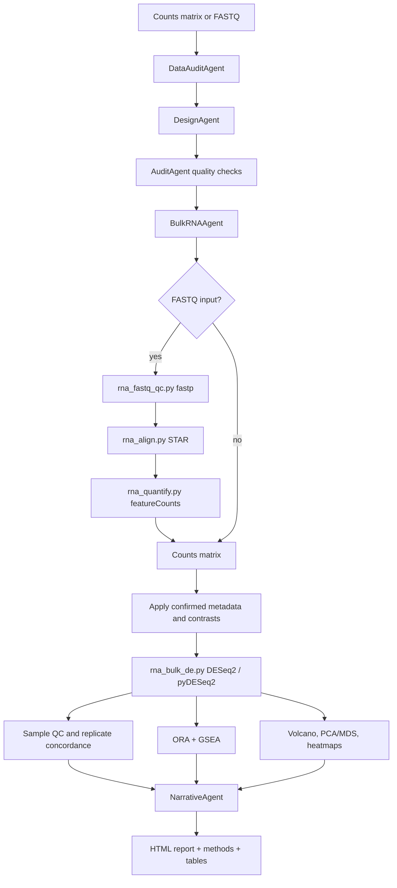

# Bulk RNA-seq Workflow

Validation level: **validated (`production`)** for both count matrices and
universal multi-platform raw FASTQ preprocessing (`ADR-075`). Publication still
requires expert review of the experimental design, fitted model, power, QC, and
conclusions.

## Goal

Run differential expression and pathway analysis for bulk RNA-seq experiments —
from either pre-computed count matrices or raw short-read FASTQ libraries across
four bulk platform families — after confirming the biological design.

## Inputs

Validated `production` entry points:

- **Count matrices:** genes as rows and samples as columns with explicit sample
  metadata and requested contrasts.
- **Universal raw FASTQ (`bulk_RNA_raw`):**
  1. **`full_length` (default):** TruSeq Stranded (`-s 2`), NEBNext, Ligation
     (`-s 1`), Ribo-Zero (`-s 0`), SMART-Seq bulk (SE, PE, multi-lane
     `L001..L00N`) -> `fastp` + `STAR` 2-pass + `pysam` multi-contig fail-closed
     auto-strandedness + `featureCounts` (`TPM` + `CPM` supplementary tables).
  2. **`tag_3prime` & `tag_5prime`:** Lexogen QuantSeq 3' FWD/REV, Takara
     SMART-3Seq, 5' CAGE / nanoCAGE / RAMPAGE -> `fastp` (`--trim_poly_x`,
     `--trim_poly_g`, `min_length=20`) + `STAR` 1-pass (preserving terminal
     soft-clipped tags) + `featureCounts` (`counts_cpm.tsv` exported; `TPM`
     suppressed due to gene-length bias).
  3. **`umi_bulk`:** QuantSeq-UMI, QIAseq UPX, SMARTer UMI, nanoCAGE-UMI ->
     `fastp --umi` + `STAR` + `rna_umi_dedup.py` (directional 1-Hamming UMI
     graph collapse per `(chrom, strand, 5'-anchor)`) + `featureCounts`.
  4. **`pooled_plate_bulk`:** BRB-seq, DRUG-seq, Prime-seq, QuantSeq-Pool,
     CEL-Seq2 bulk plates with a typed `pooled_plate_manifest`
     (`barcode_to_sample` + CB/UMI geometry) -> `rna_starsolo_bulk.py`
     (`STAR --soloType CB_UMI_Simple --soloUMIdedup 1MM_Directional_UMItools`).

## Design Questions

ARIA must confirm:

- organism;
- main factor, such as condition, genotype, treatment, or timepoint;
- group labels;
- biological replicate structure;
- batch covariates, if present;
- reference/control interpretation.

## Flow

The same diagram is stored as [bulk_rna_flow.mmd](../diagrams/bulk_rna_flow.mmd).

## Outputs

- explicitly confirmed contrasts;
- FASTQ QC, alignment, and quantification summaries when preprocessing runs;
- DE tables per contrast;
- pathway enrichment per contrast;
- volcano plots;
- PCA/MDS and heatmaps;
- report methods with design formula and thresholds;
- warnings for missing dependencies or skipped optional analyses.

## Failure Rules

- Missing pyDESeq2 must not silently produce fake DE.
- Missing fastp, STAR, or featureCounts must fail explicitly unless mock mode is
  explicitly enabled for development.
- Missing pathway tools must produce explicit warnings.
- Outlier pruning must preserve minimum replicate structure.
- One-replicate groups should be handled explicitly and conservatively.

## Current Evidence

- synthetic regression suite: `python tests/test_bulk_rna.py`;
- H9 three-condition workflow with prespecified knockout-versus-control
  contrasts;
- pyDESeq2 API compatibility path for old and new interfaces.

ARIA does not generate every pairwise contrast automatically in production. A
count matrix run requires explicit sample metadata and requested contrasts; it
does not recover a failed design from filenames unless a development-only
fallback is deliberately enabled and visibly caveated.
