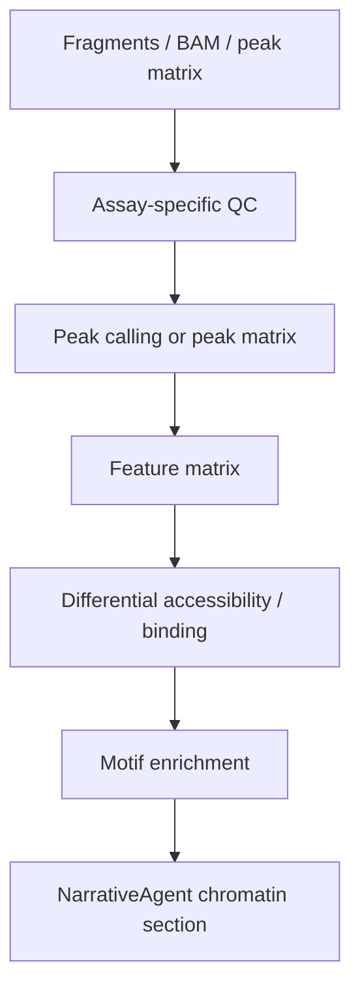

# Chromatin Workflows

Validation level: `scATAC` is **production** (`ADR-076`, governed at `CP3.5` by
`ScATACAuditAgent` — auto-dispatching exploratory single-cohort runs and `n>=3`
donor-aware pseudobulk contrasts, requiring acknowledgement for `n==2` low-power
contrasts, and blocking `n<2` or batch-confounded contrasted designs), whereas
`bulk_ATAC` remains **beta + requires explicit acknowledgement** (`CP3.5`, `ADR-056`).
Even on the promoted `scATAC` spine, optional sub-layers keep explicit statistical
scope limits: per-cluster Wilcoxon markers remain descriptive rankings, `gene_scores`
remain caveated, and differential TF footprinting (`TOBIAS`) is a DESCRIPTIVE
candidate ranking, not FDR-controlled significance, when it contrasts a single
pseudobulk per condition without `>=3` explicit biological replicates per group
(preprint audit B7).
ChIP-seq, CUT&RUN, and CUT&TAG remain
scaffolded. The authoritative per-modality tier lives in the orchestrator's
`MODALITY_VALIDATION` (single source) and is mirrored in `docs/validation_status.md`.

## Target Assays

- scATAC-seq;
- bulk ATAC-seq;
- ChIP-seq;
- CUT&RUN;
- CUT&TAG.

## Existing Pieces

- `ChromatinAgent`;
- raw-read ingestion: `atac_align.py` (bulk ATAC FASTQ→BAM, bwa-mem2),
  `chromatin_scatac_align.py` (scATAC FASTQ→fragments, chromap),
  `chromatin_fragments_to_matrix.py` (fragments→cell×peak matrix, snapatac2);
- `chromatin_qc.py`;
- `chromatin_lsi_clustering.py`;
- `chromatin_diffacc.py`;
- `chromatin_motifs.py`;
- `chromatin_peaks.py`;
- `chromatin_peak_counts.py`;
- `chromatin_bulk_diffacc.py`;
- `chromatin_peak_annotation.py` (genomic peak annotation);
- `chromatin_peak_ora.py` (functional ORA over peak-linked genes);
- `chromatin_footprint_tobias.py` (TOBIAS Tn5-bias-corrected footprinting,
  scATAC + bulk condition-level);
- MACS3 parameter profiles for assay types;
- chromatin narrative blocks + publication figures (dual PNG+SVG);
- GEO/SRA connector recognizes and routes all four ARIA modalities
  (scRNA/bulk_RNA/scATAC/bulk_ATAC); E6 retrieves supplementary archives or all
  SRA runs into private staging, validates content + hashes, preserves mixed-library
  per-file modality, and publishes only a complete generation. Raw SRA requires the
  external SRA Toolkit; downstream assay-specific readiness contracts remain binding.

## Current scATAC Production Path (`ADR-076`)

`scATAC` reaches the unified matrix pipeline from three entry points: single or
multi-file `.h5mu`/`.h5ad` peak matrices (merged onto a genomic-overlap consensus
peak universe via `chromatin_merge_matrices.py`, honoring `ADR-043`); single or
multi-sample `fragments.tsv(.gz)` inputs (`chromatin_fragments_to_matrix.py`
`snapatac2` bridge with 100% offline `ARIA_AIR_GAPPED=1` local `.fai`/FASTA support
and `A4` stage resume); and universal raw FASTQs (`chromatin_scatac_align.py`
`chromap` supporting multi-lane `L001..L00N`, platform presets `10x_atac`,
`10x_multiome_atac`, `sci_atac`, `share_seq`, `surecell`, or custom `--read-format`,
and automatic direct/reverse-complement barcode-whitelist detection failing closed
on `barcode_whitelist_mismatch`). The `production` spine runs measured QC (incl.
TSSe/FRiP gating figures), TF-IDF/LSI clustering, descriptive per-cluster
accessibility markers, donor-aware `pyDESeq2` pseudobulk condition-DA, genomic peak
annotation (`chromatin_peak_annotation.py`), local GMT functional ORA
(`chromatin_peak_ora.py`), `JASPAR2024` motif enrichment, Signac-calibrated cis
`peak2gene` (`ADR-068`), optional `beta` `TOBIAS` footprinting + RNA cross-evidence,
caveated `gene_scores`, and `C3`-verified chromatin report blocks (`ledger://chromatin/scatac_preprocessing`) + publication figures.

Missing resources or underpowered designs are reported as skipped/limited analyses,
not inferred around. chromVAR-style per-cell motif activity remains out of scope.

## Current Bulk ATAC Beta Path

Bulk ATAC exposes the implemented ATAC beta workflow behind CP3.5
acknowledgement. It is not presented as universally publication-grade;
footprinting is descriptive-only when its replicate-aware inference contract is
not met. The lane was exercised end-to-end on ENCODE replicates (K562 vs
GM12878): raw FASTQ→BAM
(`atac_align.py`, bwa-mem2 + ATAC filtering) or aligned BAM/CRAM input → measured QC
→ MACS3 peak calling with overlap-reproducibility consensus → peak-by-sample count
matrix (`bedtools coverage -sorted -counts`) → replicate-gated DESeq2 differential
accessibility (`chromatin_bulk_diffacc.py`) → genomic peak annotation → functional
ORA → TF motif enrichment → condition-level TOBIAS footprinting → figures. DA
requires explicit condition, biological replicate, and comparison metadata;
under-specified designs return structured skips. FRiP is computed only when the real
post-peak-counting tools succeed; ARIA does not substitute a default FRiP. n=2
isogenic designs run with a low-power warning (directional, not FDR-calibration).

## Optional Sub-Layers & Remaining Roadmap

For `scATAC` optional layers (`scATAC` core spine is `production` under `ADR-076`):

- chromVAR per-cell motif activity if that becomes a product goal;
- independent threshold calibration if `gene_scores` is ever promoted beyond caveated exploratory status;
- `TOBIAS` footprinting remains `beta` (`Dockerfile.tobias`), descriptive unless `>=3` biological replicates per group are supplied.

For bulk ATAC (QC→peaks→DA→annotation→ORA→motifs→footprinting→figures and raw
FASTQ→BAM are implemented and real-validated on ENCODE replicates):

- broader real-data validation across more replicated cohorts and tissues;
- chromatin CI lane (env solve + chr20 smoke) for external reproducibility;
- the readiness ADR + release review before any production promotion.

For ChIP / CUT&RUN / CUT&TAG:

- robust BAM/fragment validation;
- assay-specific QC;
- peak calling and consensus peak strategy;
- differential binding;
- motif/pathway summary;
- report methods.

## Proposed Flow

## Release Recommendation

`scATAC` is promoted to **production** (`ADR-076`, governed by `ScATACAuditAgent`),
while `bulk_ATAC` and paired same-cell RNA+ATAC integration remain available as
acknowledgement-gated **beta** lanes (`ADR-056`, `ADR-071`); scaffolded chromatin
assays (ChIP/CUT&RUN/CUT&TAG) remain blocked from publication-looking dispatch.
