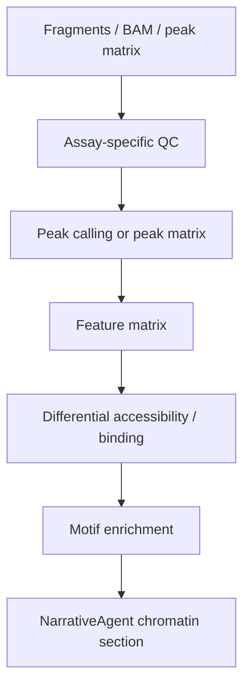

# Chromatin Workflows

Validation level: BOTH `scATAC` (`ADR-076`, governed at `CP3.5` by
`ScATACAuditAgent`) and `bulk_ATAC` (`ADR-077`, governed at `CP3.5` by
`BulkATACAuditAgent`) are **production** — auto-dispatching exploratory
single-cohort profiling runs and `n>=3` biological-replicate contrasts, requiring
explicit acknowledgement for `n==2` low-power contrasts (such as ENCODE isogenic
replicates), and blocking `n<2`, batch-confounded, or misrouted single-cell
barcoded FASTQ designs.
Even on the promoted `scATAC` and `bulk_ATAC` spines, optional sub-layers keep
explicit statistical scope limits: per-cluster Wilcoxon markers remain descriptive
rankings, `gene_scores` remain caveated, and differential TF footprinting (`TOBIAS`)
is a DESCRIPTIVE candidate ranking, not FDR-controlled significance, when it
contrasts a single pseudobulk or pooled condition BAM without `>=3` explicit
biological replicates per group (preprint audit B7).
ChIP-seq, CUT&RUN, and CUT&TAG remain
scaffolded. The authoritative per-modality tier lives in the orchestrator's
`MODALITY_VALIDATION` (single source) and is mirrored in `docs/validation_status.md`.

## Target Assays

- scATAC-seq;
- bulk ATAC-seq;
- ChIP-seq;
- CUT&RUN;
- CUT&TAG.

## Existing Pieces

- `ChromatinAgent`;
- raw-read ingestion: `atac_align.py` (bulk ATAC FASTQ→BAM, bwa-mem2),
  `chromatin_scatac_align.py` (scATAC FASTQ→fragments, chromap),
  `chromatin_fragments_to_matrix.py` (fragments→cell×peak matrix, snapatac2);
- `chromatin_qc.py`;
- `chromatin_lsi_clustering.py`;
- `chromatin_diffacc.py`;
- `chromatin_motifs.py`;
- `chromatin_peaks.py`;
- `chromatin_peak_counts.py`;
- `chromatin_bulk_diffacc.py`;
- `chromatin_peak_annotation.py` (genomic peak annotation);
- `chromatin_peak_ora.py` (functional ORA over peak-linked genes);
- `chromatin_footprint_tobias.py` (TOBIAS Tn5-bias-corrected footprinting,
  scATAC + bulk condition-level);
- MACS3 parameter profiles for assay types;
- chromatin narrative blocks + publication figures (dual PNG+SVG);
- GEO/SRA connector recognizes and routes all four ARIA modalities
  (scRNA/bulk_RNA/scATAC/bulk_ATAC); E6 retrieves supplementary archives or all
  SRA runs into private staging, validates content + hashes, preserves mixed-library
  per-file modality, and publishes only a complete generation. Raw SRA requires the
  external SRA Toolkit; downstream assay-specific readiness contracts remain binding.

## Current scATAC Production Path (`ADR-076`)

`scATAC` reaches the unified matrix pipeline from three entry points: single or
multi-file `.h5mu`/`.h5ad` peak matrices (merged onto a genomic-overlap consensus
peak universe via `chromatin_merge_matrices.py`, honoring `ADR-043`); single or
multi-sample `fragments.tsv(.gz)` inputs (`chromatin_fragments_to_matrix.py`
`snapatac2` bridge with 100% offline `ARIA_AIR_GAPPED=1` local `.fai`/FASTA support
and `A4` stage resume); and universal raw FASTQs (`chromatin_scatac_align.py`
`chromap` supporting multi-lane `L001..L00N`, platform presets `10x_atac`,
`10x_multiome_atac`, `sci_atac`, `share_seq`, `surecell`, or custom `--read-format`,
and automatic direct/reverse-complement barcode-whitelist detection failing closed
on `barcode_whitelist_mismatch`). The `production` spine runs measured QC (incl.
TSSe/FRiP gating figures), TF-IDF/LSI clustering, descriptive per-cluster
accessibility markers, donor-aware `pyDESeq2` pseudobulk condition-DA, genomic peak
annotation (`chromatin_peak_annotation.py`), local GMT functional ORA
(`chromatin_peak_ora.py`), `JASPAR2024` motif enrichment, Signac-calibrated cis
`peak2gene` (`ADR-068`), optional `beta` `TOBIAS` footprinting + RNA cross-evidence,
caveated `gene_scores`, and `C3`-verified chromatin report blocks (`ledger://chromatin/scatac_preprocessing`) + publication figures.

Missing resources or underpowered designs are reported as skipped/limited analyses,
not inferred around. chromVAR-style per-cell motif activity remains out of scope.

## Current Bulk ATAC Production Path (`ADR-077`)

`bulk_ATAC` reaches the unified chromatin spine from three entry points: universal
raw SE/PE/multi-lane FASTQ cohorts (`rna_fastq_qc.py` `fastp` + `atac_align.py`
`bwa-mem2` with SE/PE alignment flags, duplicate removal, mitochondrial contig
stripping, and `A4` stage-manifest resume), aligned BAM/CRAM cohorts, or
pre-computed peak-by-sample count matrices (`.tsv`/`.csv`). It is governed by
`BulkATACAuditAgent` and is not presented as universally publication-grade without
expert design review; footprinting (`TOBIAS`) remains `beta` and descriptive-only
when its replicate-aware inference contract is not met. The production spine runs
100% local `pysam` + `bedtools` + local-GTF ENCODE QC (per-sample and cohort FRiP,
BAM-level TSS enrichment, duplicate rate, mitochondrial fraction, and paired-end
insert-size nucleosomal banding across all samples) → SE/PE auto-detected `MACS3`
peak calling with overlap-reproducibility consensus and optional blacklist
filtering → integer and `CPM` peak-by-sample matrices (`chromatin_peak_counts.py`,
`bedtools coverage -sorted -counts`) → replicate-gated `pyDESeq2` differential
accessibility (`chromatin_bulk_diffacc.py`, externally concordant with R `DESeq2`,
`edgeR`, and `limma-voom` on multi-replicate + batch cohorts and ENCODE `K562` vs
`GM12878`) → genomic peak annotation → local GMT functional ORA → `JASPAR2024` TF
motif enrichment → optional `beta` `TOBIAS` footprinting → `C3`-verified report
blocks (`ledger://chromatin/bulk_atac_preprocessing`) and dual PNG+SVG PCA, QC,
Volcano, and MA figures (`chromatin_figure_bulk.py`). `n=2` isogenic designs
require explicit `CP3.5` acknowledgement and run with a low-power warning
(directional, not FDR-calibration).

## Optional Sub-Layers & Remaining Roadmap

For `scATAC` and `bulk_ATAC` optional layers (core spines are `production` under `ADR-076` and `ADR-077`):

- chromVAR per-cell motif activity if that becomes a product goal;
- independent threshold calibration if `gene_scores` is ever promoted beyond caveated exploratory status;
- `TOBIAS` footprinting remains `beta` (`Dockerfile.tobias`), descriptive unless `>=3` biological replicates per group are supplied.

For ChIP / CUT&RUN / CUT&TAG:

- robust BAM/fragment validation;
- assay-specific QC;
- peak calling and consensus peak strategy;
- differential binding;
- motif/pathway summary;
- report methods.

## Proposed Flow

## Release Recommendation

`scATAC` (`ADR-076`, `ScATACAuditAgent`) and `bulk_ATAC` (`ADR-077`,
`BulkATACAuditAgent`) are promoted to **production**, while paired same-cell
RNA+ATAC integration and `TOBIAS` footprinting remain acknowledgement-gated
**beta** lanes (`ADR-056`, `ADR-071`); scaffolded chromatin assays
(ChIP/CUT&RUN/CUT&TAG) remain blocked from publication-looking dispatch.
