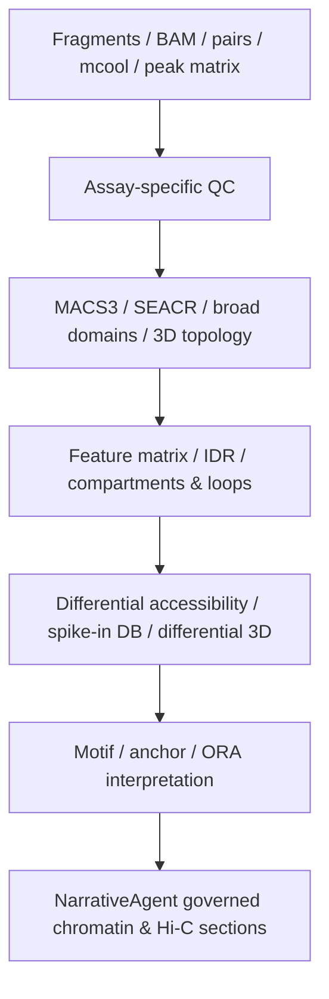

# Chromatin Workflows

Validation level: ALL FIVE chromatin assays in `ChromatinAgent` — `scATAC`
(`ADR-076`, `ScATACAuditAgent`), `bulk_ATAC` (`ADR-077`, `BulkATACAuditAgent`),
`ChIP`, `CUT_AND_RUN`, and `CUT_AND_TAG` (`ADR-081`, `ChIPAuditAgent`,
`CutAndRunAuditAgent`, `CutAndTagAuditAgent`) — plus 3D genome architecture
`HiC` / Micro-C in `GenomeArchAgent` (`ADR-082`, `HiCAuditAgent`) are
**production**. Exploratory single-cohort profiling runs and `n>=3`
biological-replicate contrasts auto-dispatch (`green`), `n==2` low-power
contrasts (or ChIP contrasts lacking an explicit Input/IgG control) require
explicit `CP3.5` acknowledgement (`yellow`), and `n<2`, batch-confounded, or
misrouted single-cell barcoded FASTQ designs fail closed (`red`).
Even on promoted spines, optional sub-layers keep explicit statistical scope
limits: per-cluster Wilcoxon markers remain descriptive rankings, `gene_scores`
remain caveated, differential TF footprinting (`TOBIAS`) downgrades to
`descriptive_only` (without claiming FDR-controlled significance) when
contrasting pooled/under-replicated (`n<3`) groups, and Hi-C `differential_3d`
likewise downgrades to `descriptive_only` without FDR-controlled significance
when `<3` biological replicates per group are provided.
The authoritative per-modality tier lives in the orchestrator's
`MODALITY_VALIDATION` (single source) and is mirrored in `docs/validation_status.md`.

## Target Assays

- scATAC-seq;
- bulk ATAC-seq;
- ChIP-seq;
- CUT&RUN;
- CUT&TAG.

## Existing Pieces

- `ChromatinAgent`;
- raw-read ingestion: `atac_align.py` (bulk ATAC FASTQ→BAM, bwa-mem2),
  `chromatin_scatac_align.py` (scATAC FASTQ→fragments, chromap),
  `chromatin_fragments_to_matrix.py` (fragments→cell×peak matrix, snapatac2);
- `chromatin_qc.py`;
- `chromatin_lsi_clustering.py`;
- `chromatin_diffacc.py`;
- `chromatin_motifs.py`;
- `chromatin_peaks.py`;
- `chromatin_peak_counts.py`;
- `chromatin_bulk_diffacc.py`;
- `chromatin_peak_annotation.py` (genomic peak annotation);
- `chromatin_peak_ora.py` (functional ORA over peak-linked genes);
- `chromatin_footprint_tobias.py` (TOBIAS Tn5-bias-corrected footprinting,
  scATAC + bulk condition-level);
- MACS3 parameter profiles for assay types;
- chromatin narrative blocks + publication figures (dual PNG+SVG);
- GEO/SRA connector recognizes and routes all four ARIA modalities
  (scRNA/bulk_RNA/scATAC/bulk_ATAC); E6 retrieves supplementary archives or all
  SRA runs into private staging, validates content + hashes, preserves mixed-library
  per-file modality, and publishes only a complete generation. Raw SRA requires the
  external SRA Toolkit; downstream assay-specific readiness contracts remain binding.

## Current scATAC Production Path (`ADR-076`)

`scATAC` reaches the unified matrix pipeline from three entry points: single or
multi-file `.h5mu`/`.h5ad` peak matrices (merged onto a genomic-overlap consensus
peak universe via `chromatin_merge_matrices.py`, honoring `ADR-043`); single or
multi-sample `fragments.tsv(.gz)` inputs (`chromatin_fragments_to_matrix.py`
`snapatac2` bridge with 100% offline `ARIA_AIR_GAPPED=1` local `.fai`/FASTA support
and `A4` stage resume); and universal raw FASTQs (`chromatin_scatac_align.py`
`chromap` supporting multi-lane `L001..L00N`, platform presets `10x_atac`,
`10x_multiome_atac`, `sci_atac`, `share_seq`, `surecell`, or custom `--read-format`,
and automatic direct/reverse-complement barcode-whitelist detection failing closed
on `barcode_whitelist_mismatch`). The `production` spine runs measured QC (incl.
TSSe/FRiP gating figures), TF-IDF/LSI clustering, descriptive per-cluster
accessibility markers, donor-aware `pyDESeq2` pseudobulk condition-DA, genomic peak
annotation (`chromatin_peak_annotation.py`), local GMT functional ORA
(`chromatin_peak_ora.py`), `JASPAR2024` motif enrichment, Signac-calibrated cis
`peak2gene` (`ADR-068`), `production` `TOBIAS` differential TF footprinting + RNA cross-evidence (`ADR-078`, associative; replicate-mean Welch/paired/batch-OLS + BH when `n>=3`, `descriptive_only` when pooled),
caveated `gene_scores`, and `C3`-verified chromatin report blocks (`ledger://chromatin/scatac_preprocessing`) + publication figures.

Missing resources or underpowered designs are reported as skipped/limited analyses,
not inferred around. chromVAR-style per-cell motif activity remains out of scope.

## Current Bulk ATAC Production Path (`ADR-077`)

`bulk_ATAC` reaches the unified chromatin spine from three entry points: universal
raw SE/PE/multi-lane FASTQ cohorts (`rna_fastq_qc.py` `fastp` + `atac_align.py`
`bwa-mem2` with SE/PE alignment flags, duplicate removal, mitochondrial contig
stripping, and `A4` stage-manifest resume), aligned BAM/CRAM cohorts, or
pre-computed peak-by-sample count matrices (`.tsv`/`.csv`). It is governed by
`BulkATACAuditAgent` and is not presented as universally publication-grade without
expert design review; `TOBIAS` differential TF footprinting (`ADR-078`) is `production`
(`production_associative`) and downgrades automatically to `descriptive_only`
when its replicate-aware inference contract (`n>=3` non-confounded replicates per condition) is not met. The production spine runs
100% local `pysam` + `bedtools` + local-GTF ENCODE QC (per-sample and cohort FRiP,
BAM-level TSS enrichment, duplicate rate, mitochondrial fraction, and paired-end
insert-size nucleosomal banding across all samples) → SE/PE auto-detected `MACS3`
peak calling with overlap-reproducibility consensus and optional blacklist
filtering → integer and `CPM` peak-by-sample matrices (`chromatin_peak_counts.py`,
`bedtools coverage -sorted -counts`) → replicate-gated `pyDESeq2` differential
accessibility (`chromatin_bulk_diffacc.py`, externally concordant with R `DESeq2`,
`edgeR`, and `limma-voom` on multi-replicate + batch cohorts and ENCODE `K562` vs
`GM12878`) → genomic peak annotation → local GMT functional ORA → `JASPAR2024` TF
motif enrichment → `production` `TOBIAS` differential TF footprinting (`ADR-078`) → `C3`-verified report
blocks (`ledger://chromatin/bulk_atac_preprocessing`) and dual PNG+SVG PCA, QC,
Volcano, and MA figures (`chromatin_figure_bulk.py`). `n=2` isogenic designs
require explicit `CP3.5` acknowledgement and run with a low-power warning
(directional, not FDR-calibration).

## Optional Sub-Layers & Remaining Roadmap

For `scATAC` and `bulk_ATAC` optional layers (core spines are `production` under `ADR-076` and `ADR-077`):

- chromVAR per-cell motif activity if that becomes a product goal;
- independent threshold calibration if `gene_scores` is ever promoted beyond caveated exploratory status;
- `TOBIAS` differential TF footprinting is `production` (`ADR-078`, `Dockerfile.tobias`), running replicate-mean Welch, paired-donor, or batch-adjusted OLS + BH-FDR when `>=3` biological replicates per group are supplied and downgrading to `descriptive_only` otherwise.

## Current ChIP-seq, CUT&RUN, CUT&TAG (`ADR-081`) & Hi-C (`ADR-082`) Production Paths

- **Epigenomic Protein–DNA Interaction Spine (`ADR-081`):** `ChIP`, `CUT_AND_RUN`,
  and `CUT_AND_TAG` share universal raw SE/PE/multi-lane FASTQ alignment
  (`atac_align.py` with `remove_duplicates=False` default for low-background
  `CUT_AND_TAG` and heterologous spike-in read counting), BAM/CRAM cohort QC
  (`NRF`, `PBC1`, `PBC2`, strand cross-correlation `NSC`/`RSC`, `IP vs control JSD`,
  subnucleosomal `<120 bp` vs mononucleosomal `140–250 bp` banding, `FRiP`, `TSSe`),
  assay-aware peak calling (`MACS3` narrow/broad, deterministic Meers et al. 2019
  `SEACR` `stringent`/`relaxed` with IgG `norm`/`non` or top-`q` thresholding, and
  `call_broad_domains` megadomains), Li et al. (2011) bimodal Gaussian-copula EM
  `IDR` consensus (`compute_idr_reproducible_peaks`), normalized BigWig export,
  heterologous spike-in (`sacCer3` / `E. coli`) `size_factors` differential binding
  over `pyDESeq2` (`epigenomic_spikein_de.py`, `0` diff on `deseq2.py`), genomic
  peak annotation, local GMT ORA, `JASPAR2024` motif enrichment, and `C3`-verified
  `ChromatinNarrator` reporting.
- **3D Genome Architecture Spine (`ADR-082`):** `HiC` / Micro-C runs in locked
  `aria-hic-env` (`Dockerfile.hic`) via `GenomeArchAgent` across `.mcool`, `.cool`,
  `.hic`, `.pairs(.gz)`, chimeric BAM, and raw paired Hi-C FASTQs (`bwa-mem2 mem -SP5M`
  + `pairtools` + `cooler zoomify` with `A4` resume), exact `clr.pixels()` QC + ICE
  balancing + $P(s)$ slope + HiCRep `SCC`, GC/gene-density-phased `cooltools.eigs_cis`
  compartments, Crane `insulation` TADs, `dotfinder.dots` chromatin loops + GTF anchor
  annotation, multi-replicate empirical-Bayes `differential_3d`, dual PNG+SVG figures,
  `HiCNarrator` (`ledger://hic/*`), and `HypothesisAgent` `adapters/hic.py`
  (`HIC_LOOP_ASSOCIATIVE`).

## Proposed Flow

## Release Recommendation

All **9/9** single-assay modalities in `MODALITY_VALIDATION` (`scRNA`, `bulk_RNA`,
`bulk_RNA_raw`, `scATAC`, `bulk_ATAC`, `ChIP`, `CUT_AND_RUN`, `CUT_AND_TAG`, `HiC`),
`TOBIAS` differential TF footprinting (`ADR-078`), paired same-cell RNA+ATAC
multiome integration (`ADR-079`), and non-same-cell RNA $\times$ ATAC contrast/donor
concordance (`ADR-080`) are promoted to **production**; unpaired single-cell
diagonal/bridge manifold imputation remains blocked fail-closed.
