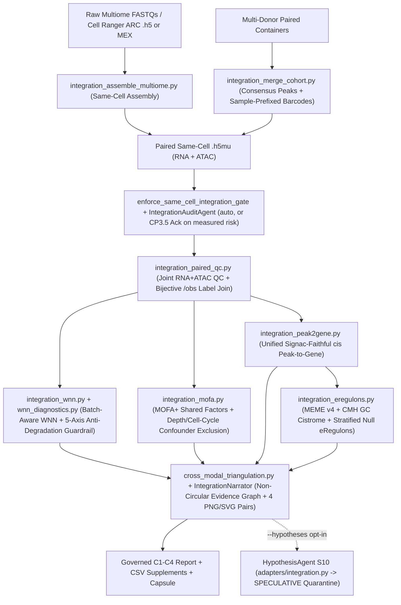

# Paired Multimodal Integration Workflow & Roadmap

Validation level: **`production` (`ADR-079`), scoped to `paired_same_cell_rna_atac`** (promoted from `beta` + `requires_ack`, `ADR-071`; policy `ADR-056`). Unpaired, diagonal, and bulk cross-modal integration remain **blocked fail-closed**.

Production covers verified paired same-cell RNA + ATAC inputs only:

- paired `.h5mu` (MuData with RNA and ATAC over one shared `obs` barcode namespace);
- Cell Ranger ARC filtered `.h5` and MEX directories (`10x_multiome_h5` / `10x_multiome_mtx`);
- raw Multiome FASTQs (`multiome_fastq_manifest`, `object_type="raw_multiome_fastq"`) with both RNA and ATAC FASTQs for every sample and a same-cell barcode translation (`10x_arc_whitelist_pair`, `barcode_map_tsv`, or `shared_barcodes` for known paired-nucleus chemistries);
- multi-donor paired cohorts (several verified paired containers, `cohort_merge_required=True`) merged onto sweep-line consensus ATAC peaks with sample-prefixed barcodes, followed by batch-aware WNN.

Every input must pass `enforce_same_cell_integration_gate`. `IntegrationAuditAgent` (`aria/agents/modality_audit.py`) dispatches a clean paired input automatically (`green` / `auto`) and asks for CP3.5 acknowledgement (`yellow` / `requires_ack`) only on measured risks: fewer than 200 shared cells (`integration_low_cell_count`), partial RNA/ATAC barcode overlap (`integration_partial_barcode_overlap`), or condition fully confounded with batch/donor in a multi-sample cohort (`integration_donor_confounded_design`). Joint topologies and regulatory links remain strictly **associative** (never causal) and act as an **additional lens** alongside per-modality results, never a replacement: `peak_to_gene`, `eregulons`, and MOFA+ factors are `production_associative`, and `HypothesisAgent` `S10` keeps any mechanistic extrapolation quarantined behind `SPECULATIVE`.

## Validated Paired Same-Cell Stack (`aria-chromatin-env` + `aria-integration-env`)

- `integration_assemble_multiome.py` + `integration_merge_cohort.py` (`ADR-079`): universal same-cell intake (Cell Ranger ARC `.h5`/MEX, split same-cell objects, raw Multiome FASTQs) and multi-donor cohort union onto consensus peaks; reconciled in the run ledger as `ledger://integration/preprocessing` only when a `.h5mu` artifact is recorded;
- `integration_paired_qc.py` (`I1`, `ADR-064`): joint RNA + ATAC cell QC and optional `h5py` `/obs`-only bijective barcode label join;
- `integration_wnn.py` + `wnn_diagnostics.py` (`I2`–`I3`, `ADR-065`..`066`): deterministic WNN joint kNN/UMAP/Leiden externally concordant with Seurat v5 (`ARI = 0.9582`, `NMI = 0.9660` on `GSE278576` `hc11`) + 5-axis anti-degradation guardrail;
- `integration_mofa.py` (`I4`, `ADR-067`): deterministic paired MOFA+ decomposition + closed-form Gaussian variational subsample projection + depth/cell-cycle confounder exclusion (concordant with `muon.tl.mofa`, Hungarian `R^2`-weighted `|r| = 0.9730`);
- `integration_peak2gene.py` (`I5`, `ADR-068`): shared `peak2gene_core.py` with `(GC, accessibility)` trans-chromosomal background null (concordant with `Signac::LinkPeaks`, `Jaccard = 0.8670`, `score_pearson = 1.0000`);
- `integration_eregulons.py` (`I6`, `ADR-069`): offline MEME v4 scanning, GC-quintile CMH cistrome enrichment, depth partial correlations, finite-population `(expr, prevalence)` null, pre-collapse BH-FDR, and paralog motif-sharing flags (`17.99x` hypergeometric edge fold-enrichment vs `scenicplus==1.0.0`);
- `cross_modal_triangulation.py` + `IntegrationNarrator` (`I7`, `ADR-070`): non-circular Cross-Modal Evidence Graph (`shared_upstream=["peak_to_gene"]`), governed C1–C4 reporting, and 4 dual PNG (`300 DPI`) + editable SVG figures;
- `aria/agents/narrative/hypothesis/adapters/integration.py` (`I9` / `S10`, `ADR-072`): opt-in `SPECULATIVE`-quarantined cross-modal `HypothesisAgent` adapter with code-owned `independence_key` preventing cis double-counting.

## Deferred / Blocked Scopes (Fail-Closed; Not Covered by `ADR-079`)

- unpaired split `scRNA + scATAC` diagonal/bridge integration (e.g., GLUE / Seurat bridge / MultiVI) remains deferred and blocked fail-closed;
- bulk cross-modal (`bulk_RNA + bulk_ATAC`), `scRNA + ChIP`, and ATAC-only `.h5mu` inputs are blocked fail-closed;
- paired containers mixed with separate unpaired `scRNA`/`scATAC` count files fail closed (`multiome_mixed_paired_and_unpaired_containers`) unless an explicit `multiome_contract` declares the pairing;
- hand-written contracts listing several paired containers without `cohort_merge_required=True` fail closed (`multiome_multiple_mudata_unsupported`);
- incomplete raw Multiome FASTQ manifests (`multiome_raw_fastq_incomplete`) and manifests without same-cell chemistry or barcode translation (`multiome_not_same_cell`) fail closed;
- any expansion beyond `paired_same_cell_rna_atac` requires its own promotion ADR under `ADR-056`; `registry_integrity.py` rejects a production tier with any other scope (`integration_production_scope_invalid`).

## Executed Paired Same-Cell Architecture

## DebateCouncil Rule

DebateCouncil should not debate from vibes. The critic must cite structured
evidence or request a concrete data lookup, for example:

- a marker value;
- a CellTypist confidence;
- a peak-to-gene correlation;
- a factor loading;
- a missing covariate.

Standalone peak-to-gene link recovery in `chromatin_regulatory.py` (`ADR-050`)
and paired `integration_peak2gene.py` (`ADR-068`) share `peak2gene_core.py`;
both remain strictly associative (`ctcf_validated=False`,
`hic_corroborated=False`).
