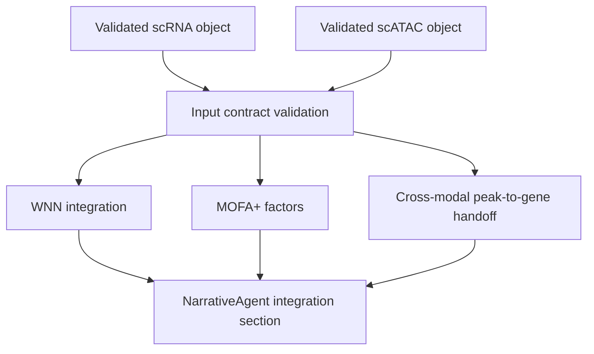

# Paired Multimodal Integration Workflow & Roadmap

Validation level: **scoped `beta` + `requires_ack` (`paired_same_cell_rna_atac`)** in `v4.8.0` (`ADR-064`..`ADR-072`); unpaired, diagonal, and bulk cross-modal integration remain **blocked fail-closed**.

Paired integration requires confirmed shared-barcode same-cell RNA + ATAC inputs (`.h5mu` or aligned same-cell objects) verified by `enforce_same_cell_integration_gate`, plus an explicit affirmative CP3.5 acknowledgement logged in `ARIAMemory`. Joint topologies and regulatory links are strictly **associative** (never causal) and act as an **additional lens** alongside per-modality results, never a replacement (`production_promoted=False` per `ADR-056`).

## Validated Paired Same-Cell Stack (`aria-chromatin-env` + `aria-integration-env`)

- `integration_paired_qc.py` (`I1`, `ADR-064`): joint RNA + ATAC cell QC and optional `h5py` `/obs`-only bijective barcode label join;
- `integration_wnn.py` + `wnn_diagnostics.py` (`I2`–`I3`, `ADR-065`..`066`): deterministic WNN joint kNN/UMAP/Leiden externally concordant with Seurat v5 (`ARI = 0.9582`, `NMI = 0.9660` on `GSE278576` `hc11`) + 5-axis anti-degradation guardrail;
- `integration_mofa.py` (`I4`, `ADR-067`): deterministic paired MOFA+ decomposition + closed-form Gaussian variational subsample projection + depth/cell-cycle confounder exclusion (concordant with `muon.tl.mofa`, Hungarian `R^2`-weighted `|r| = 0.9730`);
- `integration_peak2gene.py` (`I5`, `ADR-068`): shared `peak2gene_core.py` with `(GC, accessibility)` trans-chromosomal background null (concordant with `Signac::LinkPeaks`, `Jaccard = 0.8670`, `score_pearson = 1.0000`);
- `integration_eregulons.py` (`I6`, `ADR-069`): offline MEME v4 scanning, GC-quintile CMH cistrome enrichment, depth partial correlations, finite-population `(expr, prevalence)` null, pre-collapse BH-FDR, and paralog motif-sharing flags (`17.99x` hypergeometric edge fold-enrichment vs `scenicplus==1.0.0`);
- `cross_modal_triangulation.py` + `IntegrationNarrator` (`I7`, `ADR-070`): non-circular Cross-Modal Evidence Graph (`shared_upstream=["peak_to_gene"]`), governed C1–C4 reporting, and 4 dual PNG (`300 DPI`) + editable SVG figures;
- `aria/agents/narrative/hypothesis/adapters/integration.py` (`I9` / `S10`, `ADR-072`): opt-in `SPECULATIVE`-quarantined cross-modal `HypothesisAgent` adapter with code-owned `independence_key` preventing cis double-counting.

## Deferred / Blocked Scopes (Required Before Any Non-Paired Expansion)

- unpaired split `scRNA + scATAC` diagonal/bridge integration (e.g., GLUE / Seurat bridge / MultiVI) remains deferred and blocked fail-closed;
- multi-`.h5mu` directories without an explicit merged barcode map fail closed (`multiome_multiple_mudata_unsupported`);
- promotion beyond `beta` requires multi-cohort biological review and explicit `ADR-056` authorization.

## Proposed Flow

## DebateCouncil Rule

DebateCouncil should not debate from vibes. The critic must cite structured
evidence or request a concrete data lookup, for example:

- a marker value;
- a CellTypist confidence;
- a peak-to-gene correlation;
- a factor loading;
- a missing covariate.

Standalone peak-to-gene link recovery in `chromatin_regulatory.py` (`ADR-050`)
and paired `integration_peak2gene.py` (`ADR-068`) share `peak2gene_core.py`;
both remain strictly associative (`ctcf_validated=False`,
`hic_corroborated=False`).
